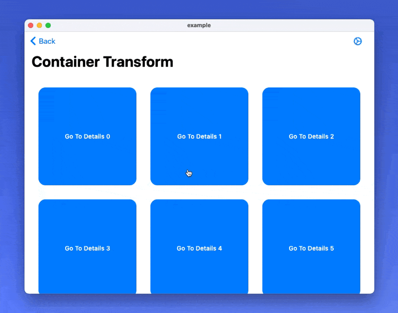

# Heroine

[](./test/)
[![Powered by Mason][mason_badge]][mason_link]
[![lints by lintervention][lintervention_badge]][lintervention_link]
[](https://bsky.app/profile/i.madethese.works)

The queen of hero transitions. Flutter's most addictive interactions.


> "this will be such an addictive #FlutterDev interaction!"
>
> ~ [Mike Rydstrom](https://x.com/RydMike/status/1876323718194184657)

[Try the interactive example in your browser](https://whynotmake-it.github.io/rivership/#/heroine).

## What Heroine adds over `Hero`

- **Spring-driven flights:** Powered by [Motor](https://pub.dev/packages/motor) so flights redirect smoothly and preserve gesture velocity.
- **Drag-to-dismiss:** Wrap any `Heroine` in `DragDismissable` for interactive, velocity-aware route dismissal.
- **Composable shuttle builders:** Cross-fade, 3D flip, fade-through color, or chain multiple effects with `.chain()`.
- **Route-aware dismissal:** Fade or transform surrounding route UI in sync with the dismiss gesture via `HeroinePageRouteMixin` and `ReactToHeroineDismiss`.
- **Nested fullscreen transitions:** Nest `Heroine` widgets across separate routes as long as they don't fly in the same transition.

## Installation

```sh
flutter pub add heroine
```

## Usage

### 1. Register `HeroineController`

Add a `HeroineController` to your app's `navigatorObservers`:

```dart
MaterialApp( // or CupertinoApp, or WidgetsApp
  home: MyHomePage(),
  navigatorObservers: [HeroineController()],
)
```

> **Note:** When using nested navigators, register a `HeroineController` on each nested navigator that participates in transitions.

### 2. Add a `Heroine`

Use `Heroine` between two routes just like Flutter's `Hero`:

```dart
// In the source route
Heroine(
  tag: 'unique-tag',
  child: MyWidget(),
)

// In the destination route
Heroine(
  tag: 'unique-tag',
  child: MyExpandedWidget(),
)
```

### 3. Customize flight transitions

Pass a built-in shuttle builder or build your own:

```dart
Heroine(
  tag: 'unique-tag',
  flightShuttleBuilder: const FlipShuttleBuilder(
    axis: Axis.vertical,
    halfFlips: 1,
  ),
  motion: Motion.bouncySpring(),
  child: MyWidget(),
)
```

Built-in shuttle builders:

- `FadeShuttleBuilder` — Cross-fade between source and destination heroes.
- `FlipShuttleBuilder` — 3D flip with configurable axis and half-flip count.
- `SingleShuttleBuilder` — Displays only the destination widget (like Flutter's default `Hero`).
- `FadeThroughShuttleBuilder` — Fades through a solid color during flight.
- `ChainedShuttleBuilder` — Combines multiple `SimpleShuttleBuilder`s (or chain them with `.chain()`).
- `HeroineShuttleBuilder.fromHero()` — Adapts an existing Flutter `HeroFlightShuttleBuilder`.

```dart
// Chaining multiple shuttle builders:
Heroine(
  tag: 'unique-tag',
  flightShuttleBuilder: const FlipShuttleBuilder()
      .chain(const FadeShuttleBuilder()),
  child: MyWidget(),
)

// Fading through a specific color:
Heroine(
  tag: 'unique-tag',
  flightShuttleBuilder: const FadeThroughShuttleBuilder(
    fadeColor: Colors.white,
  ),
  child: MyWidget(),
)
```

### Drag-to-dismiss

Wrap a `Heroine` in `DragDismissable` to enable interactive drag-to-dismiss with spring return. Dismissing pops the current route and respects its `popDisposition`:

```dart
DragDismissable(
  child: Heroine(
    tag: 'unique-tag',
    child: MyWidget(),
  ),
)
```

Use `DragDismissable.custom` to supply your own `onDismiss` callback instead of popping the route.

### Fullscreen transitions (container transform)

Like Flutter's `Hero`, Heroine cannot fly two nested heroines in the same transition. Unlike `Hero`, however, Heroine allows nesting heroines across separate routes as long as they aren't part of the same flight — enabling fullscreen container transforms across multiple routes.



See the fullscreen example implementation in [zoom_transition.dart](example/lib/zoom_transition.dart).

> **Warning:** Heroine asserts in debug builds if two nested heroines fly in the same transition, but this tree walk is skipped in release builds. Make sure nested heroines belong to distinct transitions.

### Heroine-aware routes

Mix `HeroinePageRouteMixin` into your route and use `ReactToHeroineDismiss` to animate surrounding UI as the user drags to dismiss:

```dart
class MyCustomRoute<T> extends PageRoute<T> with HeroinePageRouteMixin {
  // ... your route implementation
}

ReactToHeroineDismiss(
  builder: (context, progress, offset, child) {
    return Opacity(
      opacity: 1 - progress,
      child: child,
    );
  },
  child: MyWidget(),
)
```

As the user drags the heroine away, `progress` moves from `0` to `1` and fades `MyWidget` out in sync.

## Motion configuration

Heroine uses [Motor](https://pub.dev/packages/motor) for its flight animations, so you can pass any `Motion`:

```dart
final springMotion = Motion.spring(
  Spring.withDurationAndBounce(
    duration: Duration(milliseconds: 500),
    bounce: 0.5,
  ),
);

final cupertinoMotion = CupertinoMotion.smooth();
final linearMotion = Motion.linear(Duration(milliseconds: 300));
final ease = Motion.curved(Duration(milliseconds: 300), Curves.easeInOut);

return Heroine(
  tag: 'unique-tag',
  motion: springMotion,
  child: MyWidget(),
);
```

## Advanced features

### Continuously tracking the target

Set `continuouslyTrackTarget: true` on the destination `Heroine` if the target's layout may shift mid-flight (for example, when an autofocus text field opens the keyboard or the device rotates). Heroine checks the target's position each frame and smoothly redirects the spring while keeping its velocity. Disabled by default to avoid unnecessary per-frame layout lookups.

```dart
Heroine(
  tag: 'unique-tag',
  continuouslyTrackTarget: true,
  child: MyWidget(),
)
```

### Tickers during flight

By default (`pauseTickersDuringFlight: false`), animations inside your heroine keep running during flight. Pass `pauseTickersDuringFlight: true` to match Flutter's default `Hero` behavior of pausing child tickers while flying.

### Velocity-aware transitions

Wrap a `Heroine` in `HeroineVelocity` to hand a gesture's release velocity directly to the flight simulation (this is how `DragDismissable` passes drag velocity to the returning heroine):

```dart
HeroineVelocity(
  velocity: dragVelocity,
  child: Heroine(
    tag: 'unique-tag',
    child: MyWidget(),
  ),
)
```

### User-gesture pops

When a route is popped via a platform back gesture (such as the iOS edge swipe), Heroine skips its flight animation so the gesture and the hero don't fight each other.

## API overview

- **Core widgets:** `Heroine`, `HeroineController`, `DragDismissable`, `HeroineVelocity`, `ReactToHeroineDismiss`
- **Routes:** `HeroinePageRouteMixin`, `HeroinePageRoute`
- **Shuttle builders:** `FadeShuttleBuilder`, `FlipShuttleBuilder`, `SingleShuttleBuilder`, `FadeThroughShuttleBuilder`, `ChainedShuttleBuilder`, `SimpleShuttleBuilder`, `HeroineShuttleBuilder.fromHero()`, `.chain()`

---

[mason_link]: https://github.com/felangel/mason
[mason_badge]: https://img.shields.io/endpoint?url=https%3A%2F%2Ftinyurl.com%2Fmason-badge
[lintervention_link]: https://github.com/whynotmake-it/lintervention
[lintervention_badge]: https://img.shields.io/badge/lints_by-lintervention-3A5A40
