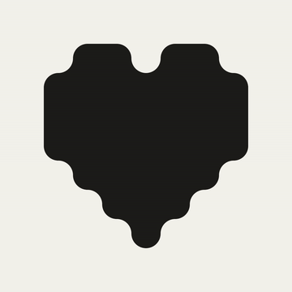
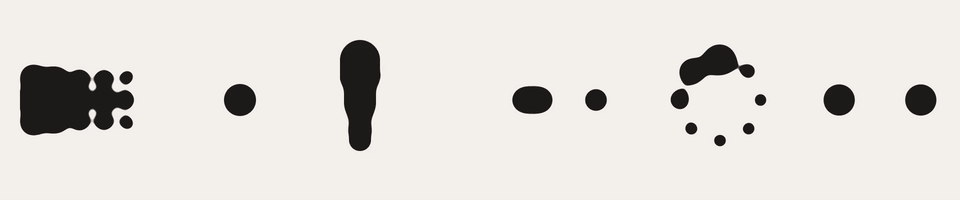
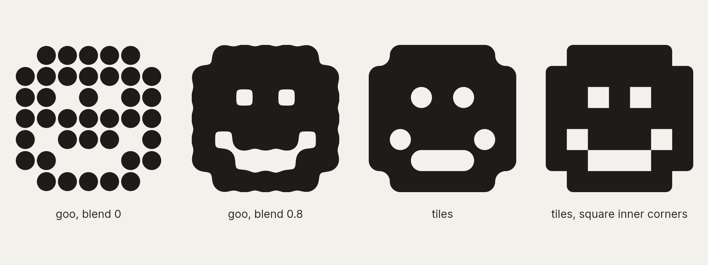
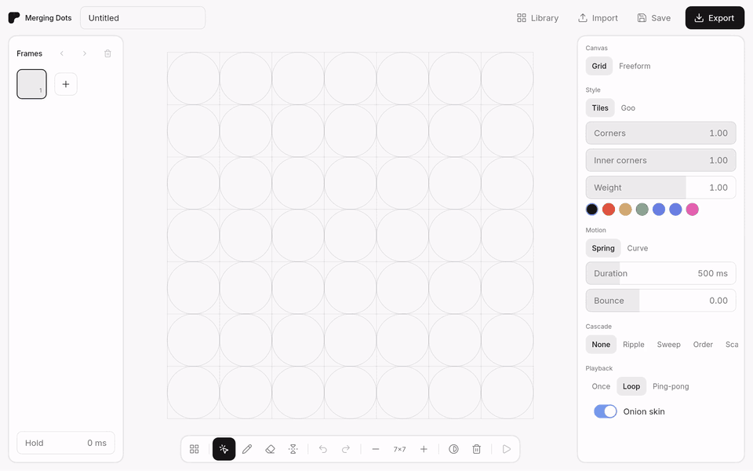
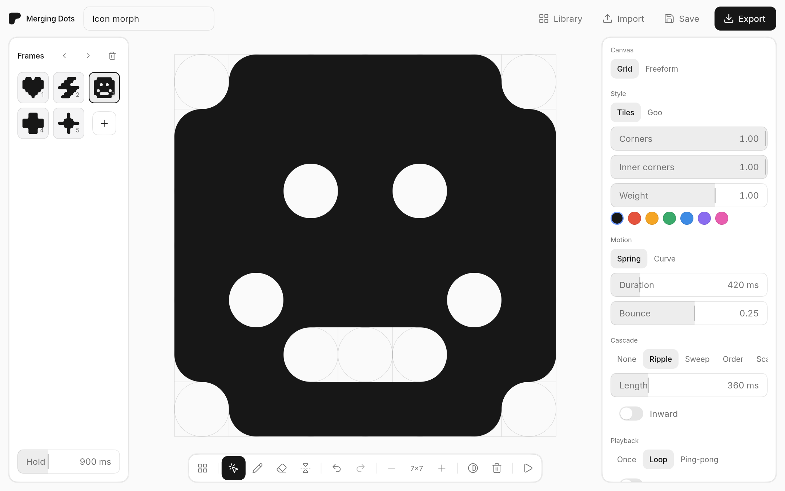
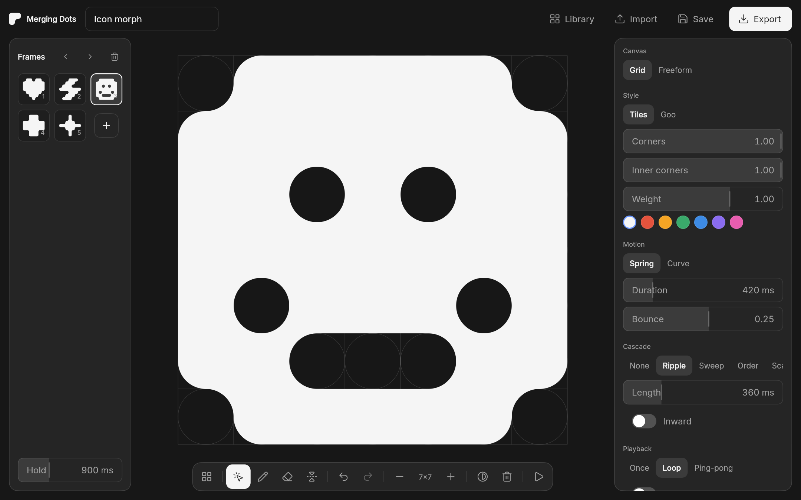

# Merging Dots

[![lints by lintervention][lintervention_badge]][lintervention_link]

Dots that merge into each other, on a grid or placed freely, animated
with [motor](../motor) and rendered by fragment shaders. Made for loading
indicators and dot-matrix icons that morph.

<p align="center"></p>



- 🫧 **Goo** - dots are signed distance fields joined with a smooth
  union, so neighbors melt together. `blend` sets how gooey, and the shape
  never depends on the order of the dots.
- 🔠 **Tiles** - full cells fuse into rounded glyphs: straight joins, round
  free corners, and concave fillets where an empty cell is wedged in.
- 🔲 **Grid renderer** - dot-matrix art up to 128 x 128. Every pixel looks
  at its 5 x 5 nearest cells, so the cost doesn't grow with the grid.
- ✳️ **Freeform renderer** - thousands of freely placed dots on a scalable
  canvas, for spinners, blobs and particles.
- 🌀 **Motor-powered motion** - any `Motion`: springs keep their momentum
  when retargeted, and staggers sweep, ripple or chase across the dots.
- 🎞️ **Sequences** - keyframes with holds, looping or ping-ponging.
- 🛠️ **Editor** - draw, animate, save, and export as Dart or JSON.



## Usage

Show a grid, and animate whenever it changes:

```dart
final heart = DotGrid.parse('''
  .##.##.
  #######
  #######
  .#####.
  ..###..
  ...#...
''');

DotGridView(
  grid: isFavorite ? heart : heart.map((_, _, v) => v * 0.4),
  style: const DotGridStyle(blend: 0.7, dotSize: 0.8),
  motion: const Motion.bouncySpring(),
  stagger: const DotStagger.radial(duration: Duration(milliseconds: 150)),
)
```

In a pattern, `.` is empty, `1` to `9` are sizes in ninths, and anything
else is full size. Without a color, dots take the ambient `IconTheme` color,
so they can stand in for an icon.

For dot-matrix glyphs, use the tiles shape. A cell counts as filled from a
value of `0.5`; animating in, it grows from a dot to its full shape:

```dart
DotGridView(
  grid: heart,
  style: const DotGridStyle.tiles(cornerRadius: 1, innerRadius: 1),
)
```

Play a sequence, like a loading indicator:

```dart
DotGridView.sequence(sequence: DotPresets.wave())

DotCloudView.sequence(
  sequence: DotPresets.gooeyBounce(),
  style: const DotCloudStyle(blend: 18),
)
```

Build your own with keyframes:

```dart
final blink = DotSequence<DotGrid>(
  [
    DotKeyframe(open, hold: const Duration(seconds: 2)),
    DotKeyframe(closed),
  ],
  motion: const Motion.snappySpring(),
  stagger: const DotStagger.directional(
    duration: Duration(milliseconds: 80),
    angle: math.pi / 2,
  ),
  loop: LoopMode.loop,
);
```

Freeform dots live on a canvas that scales to fit, like an SVG view box:

```dart
DotCloudView(
  cloud: const DotCloud(
    [Dot(30, 50, 14), Dot(70, 50, 14)],
    size: Size(100, 100),
  ),
  style: const DotCloudStyle(blend: 20),
)
```

When a cloud animates, dots are matched by index. Extra dots grow out of
nothing and missing ones shrink away.

### Shaders

The shaders load on first use, and until then dots are drawn as plain
circles. Preload them so the first frame already merges:

```dart
void main() {
  WidgetsFlutterBinding.ensureInitialized();
  DotShaders.precache();
  runApp(const MyApp());
}
```

## The editor

[`example`](./example) is an editor, built with [coil](../coil). Paint on a
grid (flip, draw or erase, optionally mirrored) or place dots freely, add
frames, tune shape, motion and cascade, and save projects on your device.
**Export** gives you Dart code to paste into your app, or JSON to load at
runtime:

```dart
final json = jsonDecode(await rootBundle.loadString('assets/loader.json'));
final sequence = DotSequence.gridFromJson(json);
final style = DotGridStyle.fromJson(json['style']);
```



| Light | Dark |
|---|---|
|  |  |

The editor needs Flutter 3.47 or newer, like coil.

### Recording the media

The images and videos above are recorded by
[snaptest](../snaptest) from the example's showcase tests. They need
FFmpeg:

```sh
cd example
flutter test --run-skipped -t showcase test/showcase
../tool/showcase_gifs.sh
```

## Performance

Merging dots is built to run many instances at once, like a list full of
animated icons:

- **No rebuilds while animating.** Each view owns one ticker and one
  `DotAnimator`. Frames only repaint the view, which is its own repaint
  boundary, and never rebuild or lay out.
- **One simulation for all dots.** Every dot samples the same motor
  simulation, shifted in time for staggers. A spring is linear in its start
  conditions, so retargeted dots keep their velocity with a second shared
  simulation instead of one per dot. Dots that don't move cost nothing.
- **Constant work per pixel on grids.** The grid's values live in a
  texture with one texel per cell. The shader reads only the 5 x 5 cells
  around each pixel.
- **Tiles for freeform dots.** Every frame the dots are sorted into tiles
  at least as large as a dot's reach, so each pixel reads only the dots of
  the 3 x 3 tiles around it. One spot can merge up to 64 dots.
- **Direct uploads on Impeller.** The per-frame data is uploaded with
  `decodeImageFromPixelsSync`. Skia and the web don't support it, so there
  the data is drawn into a texture on the GPU instead, which costs one extra
  render pass.
- **Only the dots are shaded.** Both renderers shade the bounding box of the
  visible dots, not the whole widget.
- **Crisp edges at any blend.** The union's gradient is tracked alongside
  its value, so the anti-aliased edge stays one pixel wide where dots
  bridge. Where four goo dots meet with little blend, the field can leave a
  tiny hole; a little more `blend` closes it.

[lintervention_link]: https://github.com/whynotmake-it/lintervention
[lintervention_badge]: https://img.shields.io/badge/lints_by-lintervention-3A5A40
