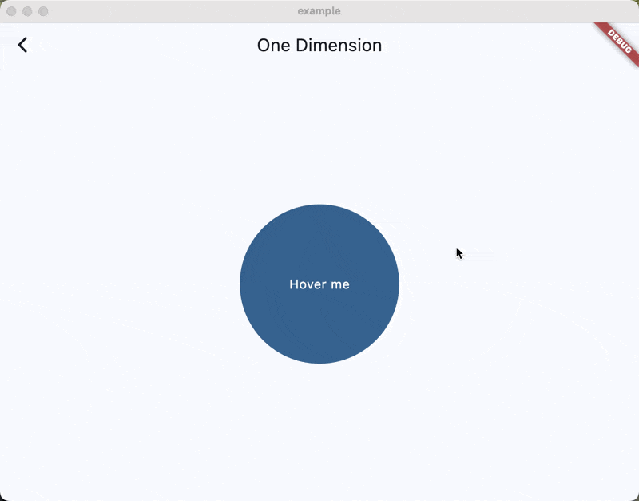
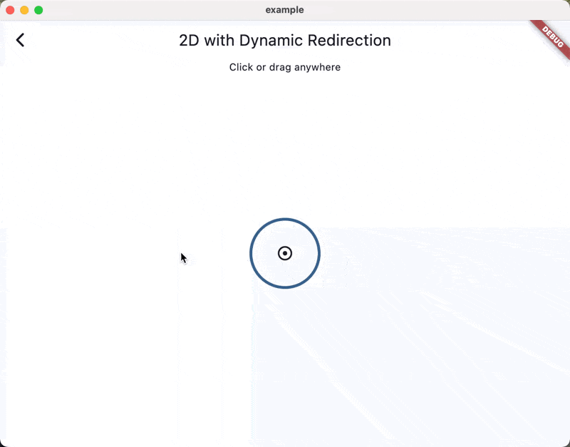

# Motor

[](https://pub.dev/packages/motor)
[](./test/)
[![lints by lintervention][lintervention_badge]][lintervention_link]
[](https://bsky.app/profile/i.madethese.works)

A unified motion system for Flutter. Animate with physics-based springs or duration-based curves through the same API.


[Try the interactive gallery in your browser](https://whynotmake-it.github.io/rivership/#/motor).

## What's in the box

- **One API for springs and curves:** Switch between spring physics, easing curves, or custom simulations without rewriting widgets or controllers.
- **Built-in design system presets:** `CupertinoMotion` mirrors SwiftUI's spring presets; `MaterialSpringMotion` implements the Material Design 3 spring tokens.
- **Multi-dimensional animation:** Animate `Offset`, `Size`, `Rect`, `Color`, angles, or your own types with an independent simulation per dimension.
- **Tracks & steps:** Choreograph multiple properties on one ticker with steps, keyframes, loops, sync barriers, and named phases.
- **Free motion:** Run self-directed physics like `FrictionMotion` (decay) and project where they will come to rest.
- **Companion packages:** Use [`motor_widgets`](../motor_widgets) for spring-driven versions of Flutter's implicit animation widgets and drag-and-drop, and [`motor_devtools`](../motor_devtools) for an optional in-app timeline inspector and spring tuner.

## Installation

Motor requires the [Flutter SDK][flutter_install_link] (Flutter 3.32 / Dart 3.8 or newer).

> **Note:** Code samples below use Dart 3.10 dot-shorthands (such as `.bouncySpring()` or `.to(...)`). On Dart 3.8–3.9, write the full form (`Motion.bouncySpring()`, `TrackStep.to(...)`, and so on).

```sh
flutter pub add 'motor:^2.0.0-dev.0'
```

Or add it to your `pubspec.yaml`:

```yaml
dependencies:
  motor: ^2.0.0-dev.0
```

## Quick start

| You want to animate… | Reach for |
|---|---|
| A single `double` | `SingleMotionBuilder` |
| A single multi-dimensional value (`Offset`, `Size`, `Color`, …) | `MotionBuilder` |
| Several properties together, or multi-step choreography | `TrackBuilder` or `PhaseTrackBuilder` |
| Imperative control (gestures, custom sequencing) | `MotionController` or `TrackController` |
| Drop-in replacements for `AnimatedContainer`, `AnimatedSwitcher`, `AnimatedSize`, etc. | [`motor_widgets`](../motor_widgets) |

Single-value builders and controllers are one-track tracks under the hood, so you can start with `SingleMotionBuilder` and move to tracks later without learning a second animation model.

### Animating a single value

Use `SingleMotionBuilder` for a `double`:



```dart
SingleMotionBuilder(
  motion: .bouncySpring(),
  value: targetSize, // Changing this redirects the spring with its current velocity.
  builder: (context, value, child) {
    return Container(
      width: value,
      height: value,
      color: Colors.blue,
    );
  },
)
```

For multi-dimensional types like `Offset`, `Size`, `Rect`, or `Color`, use `MotionBuilder` with a `MotionConverter`:



```dart
MotionBuilder(
  motion: .bouncySpring(), // Or MaterialSpringMotion.expressiveSpatialDefault()
  value: const Offset(100, 100),
  from: Offset.zero,
  converter: .offset,
  builder: (context, value, child) {
    return Transform.translate(
      offset: value,
      child: child,
    );
  },
  child: Container(
    width: 100,
    height: 100,
    color: Colors.blue,
  ),
)
```

## Motions

A `Motion` describes *how* a value moves, independent of what you're animating.

```dart
// Duration-based
final linear = Motion.linear(const Duration(seconds: 1));
final curved = Motion.curved(const Duration(seconds: 1), Curves.easeInOut);

// Physics-based
final spring = CupertinoMotion.bouncy(); // Same as Motion.bouncySpring()
final material = MaterialSpringMotion.standardSpatialDefault();
```

**Target-based motions** (`Motion`) move from a start value to a target value:

- `SpringMotion` — Physics-based spring backed by Flutter's `SpringDescription`. Snaps to the target when settling by default (`snapToEnd: true`).
- `CupertinoMotion` — `SpringMotion` subclass with Apple's SwiftUI spring presets.
- `MaterialSpringMotion` — `SpringMotion` subclass with Material Design 3 spring tokens.
- `CurvedMotion` — Duration-based animation with any Flutter `Curve`.
- `LinearMotion` — Duration-based linear animation.
- `Motion.instant` — Jumps straight to the target. Useful for reduced motion or disabling an animation.

**Free motions** (`FreeMotion`) are self-directed: they evolve from a starting value and velocity with no fixed target:

- `FrictionMotion` — Decelerates under drag, like a scroll view coasting to a stop. Call `finalValue` or `project` to calculate where it will rest without stepping through the simulation.

You can also create custom motions by extending `Motion` or `FreeMotion`.

> **Tip:** Motions and their wrappers (`scaleTo`, `trimmed`, etc.) are immutable value objects, so declare them as `const` or `static final` when convenient. Wrappers compare by value, so creating them in `build` is fine; if a simulation doesn't report its settle time, Motor probes it once per move.

### CupertinoMotion

`CupertinoMotion` matches [SwiftUI's spring presets](https://developer.apple.com/documentation/swiftui/animation):

- `CupertinoMotion()` — SwiftUI's default spring (`0.5 s`, no bounce; same as `.smooth()`).
- `.smooth()` — Smooth spring with no bounce.
- `.bouncy()` — Playful spring with higher bounce.
- `.snappy()` — Responsive spring with a small amount of bounce.
- `.interactive()` — Lower-response spring tuned for gesture-driven motion.

### MaterialSpringMotion

`MaterialSpringMotion` provides the official [Material Design 3 spring tokens](https://m3.material.io/styles/motion/overview/how-it-works#spring-tokens), split into **Spatial** (position, size, layout) and **Effects** (opacity, color) across three speeds:

| Category | Fast | Default | Slow |
|---|---|---|---|
| Standard spatial | `.standardSpatialFast()` (0.9, 1400) | `.standardSpatialDefault()` (0.9, 700) | `.standardSpatialSlow()` (0.9, 300) |
| Expressive spatial | `.expressiveSpatialFast()` (0.6, 800) | `.expressiveSpatialDefault()` (0.8, 380) | `.expressiveSpatialSlow()` (0.8, 200) |
| Standard effects | `.standardEffectsFast()` (1.0, 3800) | `.standardEffectsDefault()` (1.0, 1600) | `.standardEffectsSlow()` (1.0, 800) |
| Expressive effects | `.expressiveEffectsFast()` (1.0, 3800) | `.expressiveEffectsDefault()` (1.0, 1600) | `.expressiveEffectsSlow()` (1.0, 800) |

Values in parentheses are `(dampingRatio, stiffness)`.

### Custom springs

Customize a `CupertinoMotion` with `duration` and `bounce`, or pass any Flutter `SpringDescription` to `SpringMotion`:

```dart
final customCupertino = CupertinoMotion(
  duration: const Duration(milliseconds: 500),
  bounce: 0.2, // -1.0 to 1.0
);

final customSpring = SpringMotion(
  SpringDescription.withDampingRatio(
    mass: 1,
    ratio: 0.8,
    stiffness: 500,
  ),
);
```

> **Why does a spring run longer than its `duration`?**
> A spring's `duration` is its perceptual pace: it gets close to its target around then, while the presets take roughly twice that long to come completely to rest. Motor calls the first moment *ended* and the second *settled*; see [Timing: ended and settled](#timing-ended-and-settled).

## MotionConverter

A `MotionConverter` splits any Dart type into a list of `double`s so Motor can simulate each dimension independently. If you fling a draggable card horizontally while it settles vertically, the horizontal velocity stays on the X axis instead of distorting the Y axis.

Built-in converters:

- `MotionConverter.single` (`double`)
- `MotionConverter.angle` (`double` in radians, wrapping around `2π`)
- `MotionConverter.offset` (`Offset`)
- `MotionConverter.size` (`Size`)
- `MotionConverter.rect` (`Rect`)
- `MotionConverter.alignment` (`Alignment`)
- `MotionConverter.colorRgb` (`Color`)

### Custom converters

Pass `normalize` and `denormalize` to `MotionConverter.custom`, or extend `MotionConverter<T>`:

```dart
final vector3Converter = MotionConverter<Vector3>.custom(
  normalize: (v) => [v.x, v.y, v.z],
  denormalize: (values) => Vector3(values[0], values[1], values[2]),
);
```

```dart
class Vector3MotionConverter extends MotionConverter<Vector3> {
  const Vector3MotionConverter();

  @override
  List<double> normalize(Vector3 value) => [value.x, value.y, value.z];

  @override
  Vector3 denormalize(List<double> values) =>
      Vector3(values[0], values[1], values[2]);
}
```

Don't retain or mutate the lists passed to or returned by a converter: `denormalize` receives a buffer that Motor reuses, and Motor may hold on to the list returned by `normalize`.

### Dimensions

A converter can describe how each dimension behaves via `MotionConverter.dimensions` (default `null`, meaning all dimensions are linear):

- `MotionDimension.linear()` — Unbounded linear axis.
- `MotionDimension.periodic(period)` — Wraps every `period`, so targets always take the shortest path. `MotionConverter.angle` uses `MotionDimension.periodic(2 * pi)`: animating from `6.1 rad` (~350°) to `0.2 rad` (~11°) moves `0.38 rad` forward instead of `5.9 rad` backward.
- `MotionDimension.bounded(min, max)` — Clamps only the visible output while letting the underlying spring overshoot and preserve velocity. `ColorRgbMotionConverter` bounds its channels to `[0, 1]`.

```dart
final converter = MotionConverter<Vector3>.custom(
  normalize: (v) => [v.x, v.y, v.z],
  denormalize: (values) => Vector3(values[0], values[1], values[2]),
  dimensions: const [
    MotionDimension.periodic(360),
    MotionDimension.bounded(0, 1),
    MotionDimension.linear(),
  ],
);
```

If you `implements MotionConverter` rather than extending it, add the `dimensions` getter and return `null`.

### Directionality and `AnimationStatus`

Physics-based multi-dimensional values (`Offset`, `Size`, `Rect`, `Color`, and custom converters) don't have an inherent forward/reverse direction, so they report `forward` while moving, `completed` at rest, and `dismissed` only when settling exactly on their initial value.

`SingleMotionConverter` (`double`) is directional by default: animating `0 → 1` reports `forward` then `completed`, while `1 → 0` reports `reverse` then `dismissed`.

To add directionality to a custom type, use `MotionConverter.customDirectional`, mix in `DirectionalMotionConverter`, or mix in `ComparableMotionConverter` for `Comparable` types:

```dart
final sizeByArea = MotionConverter<Size>.customDirectional(
  normalize: (s) => [s.width, s.height],
  denormalize: (v) => Size(v[0], v[1]),
  compare: (a, b) => (a.width * a.height).compareTo(b.width * b.height),
);
```

## Tracks & Steps

When a UI transition moves, resizes, and recolors a widget at the same time — each with its own timing and motion — Motor models it with two primitives: a **`Track`** (one animated property) and a **`TrackStep`** (one instruction on that track).

### 1. Declare a `Track` per property

A `Track` pairs a converter with an optional `initial` value and an optional default `motion`:

```dart
final offset  = Track(.offset, initial: Offset.zero, motion: .smoothSpring());
final scale   = Track(.single, initial: 0.8);
final tint    = Track(.colorRgb, initial: Colors.blue, motion: .smoothSpring());
final opacity = Track(.single, initial: 0.0, motion: .smoothSpring());
```

A track is identified by its object instance, not its fields. Declare each track once (as a `final` field or top-level variable) and reuse it — don't construct tracks inline inside `build`.

If `initial` is omitted, a controller looks up the starting value in this order: the controller's `initialValues`, the animation's `from:`, the track's `initial`, and finally a zero value matching the first target's dimensions.

### 2. Give a track a list of steps

A `Track` is callable: pass it an ordered list of steps. Even a single move is a one-element list:

```dart
scale([.to(1, motion: .bouncySpring())]);

offset([
  .at(const Duration(milliseconds: 300), const Offset(0, 100)),
  .to(.zero, motion: .bouncySpring()),
]);
```

Available steps:

- `.to(value, motion:, until:)` — Animate toward `value` (falling back to the track's default `motion`). By default, the next step begins once this step has settled; pass `until: .ended` to hand off after the motion's `duration` while a spring is still settling.
- `.at(time, value, motion:)` — Keyframe: arrive at `value` at `time` on the track's clock (measured from when the track started, resetting each loop cycle, or from the start of its phase in a `TrackPhaseTimeline`). With time to spare, the `.at` motion starts as soon as the previous step finishes and stretches to land on `time`; with too little time, the previous step is cut short so the `.at` motion can run at its natural speed and arrive on schedule. Times cannot go backward past preceding `.hold`s.
- `.hold(duration)` — Wait for `duration` at the current value. A preceding spring with `until: .ended` continues settling during the hold.
- `.free(motion:)` — Hand off to a self-directed `FreeMotion` (such as `FrictionMotion`) from the current value and velocity until it comes to rest.
- `.sync(token:)` — Wait at a barrier until every other track sharing `token` arrives (see [Sync barriers](#sync-barriers)).

Every `.to` and `.at` step needs a motion, either on the step itself or as the track's default (asserted in debug mode).

```dart
offset([
  // Finishes at 200 ms, leaving 800 ms before the keyframe.
  .to(const Offset(0, 50), motion: .linear(const Duration(milliseconds: 200))),
  // Starts at 200 ms and slows down to land at 1 s.
  .at(
    const Duration(seconds: 1),
    const Offset(100, 50),
    motion: .curved(const Duration(milliseconds: 300), Curves.easeOut),
  ),
]);
```

### 3. Read values with the `value` reader

Because several tracks can animate together, builders pass a **`value` reader** function instead of a single value. Call it with a track to read that track's current typed value:

```dart
final Offset o = value(offset);
final double s = value(scale);
```

### 4. Play tracks together with `TrackBuilder`

`TrackBuilder` runs a list of track animations on a single ticker and rebuilds with the `value` reader:

```dart
TrackBuilder(
  animations: [
    scale([.to(1, motion: .bouncySpring())]),
    offset([
      .at(const Duration(milliseconds: 300), const Offset(0, 100)),
      .to(.zero, motion: .bouncySpring()),
    ]),
    tint([
      .hold(const Duration(milliseconds: 120)),
      .to(Colors.green, motion: .smoothSpring()),
    ]),
  ],
  builder: (context, value, child) {
    return Transform.translate(
      offset: value(offset),
      child: Transform.scale(
        scale: value(scale),
        child: ColoredBox(color: value(tint), child: child),
      ),
    );
  },
)
```

Set per-track starting values or velocities directly on an animation with `from:` and `withVelocity:` (for example, `offset([.to(target)], from: start, withVelocity: fling)`).

### Repeating steps with `.loop`

Wrap any slice of steps in `.loop(...)` to repeat it. Optional parameters control the loop `mode:` (`.loop`, `.pingPong`, `.seamless`, `.none`), a finite `count:`, or a `together:` token to keep sibling loops in lockstep:

```dart
TrackBuilder(
  animations: [
    bar([
      .to(0.2), // Intro plays once.
      .loop([.to(1), .to(0.2)], together: #pulse),
    ]),
    dot([
      .loop([.to(big), .hold(d), .to(small)], together: #pulse),
    ]),
  ],
  builder: ...,
)
```

- `LoopMode.loop` (default) replays the steps in order, continuing smoothly from the current value and velocity.
- `LoopMode.pingPong` plays forward, reverses back to the loop's first target, and repeats.
- `LoopMode.seamless` jumps back to the loop's first target without animating and replays — match the last target to the first (such as `0` and `2π` for a continuous rotation) so the seam is invisible.
- `LoopMode.none` plays the steps once and continues.
- `count:` stops after that many cycles (full round-trips for `.pingPong`) and moves on to any following steps.
- `together:` makes loops sharing the same token wait for each other at the end of every cycle without writing `.sync` steps manually.

### Staggering with `delay`

Pass `delay:` on a track animation to start it later — handy for staggering list items:

```dart
TrackBuilder(
  animations: [
    for (final (i, track) in itemTracks.indexed)
      track([.to(1)], delay: Duration(milliseconds: 40 * i)),
  ],
  builder: (context, value, child) => Column(
    children: [
      for (final track in itemTracks)
        Opacity(opacity: value(track), child: const ItemTile()),
    ],
  ),
)
```

`.at` times are measured from after the delay, and the delay runs once (not on each loop cycle). `delay` is not allowed inside a `TrackPhaseTimeline`. If a track is already moving when you redirect it with a delay, the running motion keeps playing during the delay and the new animation takes over its value and velocity when the delay finishes.

### Driving tracks from state and input

You can rebuild `animations:` from widget state. When a rebuild changes one track's animation, only that track redirects from its current value and velocity while the other tracks keep running:

```dart
TrackBuilder(
  animations: [
    // Follows the pointer and springs home on release.
    offset([.to(_drag ?? .zero, motion: .interactiveSpring())]),
    // Keyframes while idle, direct target while pressed.
    if (_pressed)
      scale([.to(0.9, motion: .snappySpring())])
    else
      scale([
        .at(const Duration(milliseconds: 600), 1.05, motion: .smoothSpring()),
        .at(const Duration(milliseconds: 1200), 1, motion: .smoothSpring()),
      ]),
  ],
  builder: (context, value, child) => Transform.translate(
    offset: value(offset),
    child: Transform.scale(scale: value(scale), child: child),
  ),
)
```

### Sync barriers

When independent tracks take different amounts of time and need to meet before continuing, add a `.sync(token:)` step. Each track that reaches the barrier waits until every other track sharing `token` arrives, and then they continue together:

```dart
offset([.to(a), .sync(token: #beat), .to(b)]);
size([  .to(x), .sync(token: #beat), .to(y)]); // Both wait at #beat.
```

Barriers coordinate tracks on the same controller (one `TrackBuilder` or `TrackController`). If a track is stopped or redirected before reaching a barrier, it leaves the barrier so the remaining tracks don't stall. Scrubbing resolves barriers the same way playback does.

By default, a track reaches the barrier once the preceding step has settled. With `until: .ended` on that step, it arrives once the motion's `duration` has elapsed; the spring keeps settling while waiting, and the step after the barrier picks up from there.

### Named phases (`TrackPhaseTimeline` and `PhaseTrackBuilder`)

When an animation moves between named states (like compact, expanded, and focused), `TrackPhaseTimeline` maps each phase to its track animations and automatically inserts sync barriers between phases so every track arrives together.

Drive it with `PhaseTrackBuilder`, either manually via `currentPhase` or automatically via `playing: true`:

```dart
enum PanelPhase { compact, expanded }

PhaseTrackBuilder<PanelPhase>(
  currentPhase: _phase,
  timeline: TrackPhaseTimeline({
    .compact:  [panelSize([.to(const Size(172, 128))]), radius([.to(24)])],
    .expanded: [panelSize([.to(const Size(292, 180))]), radius([.to(34)])],
  }),
  builder: (context, value, phase, child) {
    return SizedBox.fromSize(
      size: value(panelSize),
      child: DecoratedBox(
        decoration: BoxDecoration(
          borderRadius: .circular(value(radius)),
        ),
      ),
    );
  },
)
```

- Pass `onTransition` to observe `PhaseTransitioning` and `PhaseSettled` events.
- Set `loop:` on `TrackPhaseTimeline` to control what happens after the last phase when `playing: true` (`.loop`, `.seamless`, `.pingPong`, or `.none`).
- To set starting values or velocities when the timeline begins playing, pass `initialValues:` on the timeline (`track.value(v, velocity: dv)` or `track.velocity(dv)`). Individual animations inside a phase cannot set their own `from:` or `withVelocity:` (asserted), since each phase continues from the previous one.
- To play a `TrackPhaseTimeline`'s phases once in order inside a plain `TrackBuilder` or `TrackController.animate`, use `timeline.flattened`.

### Imperative track control (`TrackController`)

For gesture-driven or imperative choreography, use `TrackController`. It implements `Animation<TrackValueReader>`, so `controller.value` is the same reader passed to `TrackBuilder`:

```dart
final controller = TrackController(vsync: this);

controller.animate([scale([.to(1.2)])]); // Play or redirect tracks.
controller.set([scale.value(1.0)]);      // Jump immediately without animating.
controller.stop(tracks: [scale]);        // Settle springs or halt these tracks.
controller.pause();                      // Freeze playback without losing the plan.
controller.scrubTo(const Duration(milliseconds: 240));
controller.resume();                     // Continue smoothly from the scrub point.
final s = controller.value(scale);       // Read the current value.
```

`PhaseTrackController` adds phase navigation (`playPhases(timeline, atPhase:)`, `goToPhase`, `currentPhase`) and is what `PhaseTrackBuilder` uses internally.

Important controller semantics:

- **Futures:** `play`, `animate`, and `stop` return a `MotionFuture` (a `TickerFuture`) scoped to the tracks started by that call. Awaiting it waits until those tracks settle, even while other tracks keep running; awaiting `.ended` completes once their last steps reach their `duration`. Restarting a track or calling `stop(canceled: true)` cancels both (`orCancel` throws `TickerCanceled`). A graceful `stop()` completes `ended` immediately and the future once the tracks settle. Looping animations never settle, so don't `await` them.
- **`stop()` vs `stop(canceled: true)`:** `stop()` lets a spring finish settling (during a free step, hold, or barrier, the track's default motion decides); `stop(canceled: true)` halts immediately. In both cases, stopped tracks keep their last direction (`forward` or `reverse`) as their status because stopping interrupts a move rather than completing it.
- **`pause()`:** Freezes the ticker without changing `status` (`isAnimating` becomes `false` while `status` stays `forward`). Intended for inspection and authoring; prefer `stop` for app logic. Starting another animation resumes paused tracks from where they stopped.
- **`scrubTo(t)`:** Positions every track on one shared controller timeline that only advances while the controller ticks, so tracks started at different times stay aligned and playback resumes cleanly from `t`.
- **Status:** The controller's `status` combines every track moved since it was last idle (`reverse` if all moving tracks are heading down, otherwise `forward`; once idle, `dismissed` if all of them are dismissed, otherwise `completed`). For a single track's status, check `animationOf(track).status`.
- **`onStep`:** Fires for every step a track enters, in order, even when multiple steps happen within a single frame.

### Interop with Flutter animations

Widgets like `FadeTransition` expect an `Animation<T>` rather than a value reader. Ask the controller for a track's `Animation<T>` with `animationOf`:

```dart
FadeTransition(opacity: controller.animationOf(opacity), child: card);
```

`animationOf` returns the same instance per track, only listens while it has listeners, notifies only when that track changes, and reports that track's own `AnimationStatus`.

Coming from Flutter's built-in animation APIs:

| Flutter | Motor |
|---|---|
| `Tween<T>` | `Track<T>` (its converter handles the type) animated directly to target values |
| `CurvedAnimation`, `Interval` | Step `motion`, `.hold`, `.at` |
| `TweenSequence` | A list of steps |
| One controller driving many tweens | One `TrackController` or `TrackBuilder` with several tracks |

You can still drive a `Tween` off `animationOf(track)` if you want one scalar value to control several properties.

### Timing: `ended` and `settled`

Motor distinguishes two moments in a motion's life:

- **Ended:** The motion's `duration` has elapsed — how long the move *feels*. A spring may still be moving slightly.
- **Settled:** The motion is completely at rest on its target.

A motion never settles before it ends, and a curve does both at the same time. `Motion.duration` is fixed for a given motion (`null` means it has no fixed length and ends when it settles). The simulation reports when it settles via `SettlingSimulation.settlesAt` or `simulation.simulateSettleTime()`.

**How steps hand off:**

- By default, the next step starts once the previous step has **settled**.
- With `until: .ended`, it starts once the previous step has **ended**, taking over its current value and velocity while a spring is still moving (matching SwiftUI's `PhaseAnimator`).
- A step inherits velocity only if the preceding motion is still moving: starting right as a curve ends inherits its ending slope, while starting after time at rest (a hold or barrier wait) starts from rest.
- A spring keeps settling during a following `.hold` or `.sync`.

```dart
opacity([
  .to(1, motion: .bouncySpring()),                 // Next step waits until settled.
  .to(0, motion: .bouncySpring(), until: .ended),  // Next step starts after 500 ms.
  .to(1),
]);
```

**How `.at` keyframes handle timing:**

- An `.at` step's natural length is its motion's `duration` (or its settle time if `duration` is `null`). Springs are cut at their duration so they land on time.
- If the previous step starts too late to leave room for that length, the `.at` motion compresses to fit; with zero time left, it arrives immediately.
- If the previous step starts after `time` has already passed, the `.at` step is skipped.
- The step after an `.at` takes over its arrival velocity; a hold, barrier, or the end of the plan comes to rest.

**Futures:**

`animateTo` doesn't have an `until:` parameter, so await `.ended` when you want to chain the next move before a spring finishes settling:

```dart
await controller.animateTo(1).ended; // After 500 ms, while still settling.
controller.animateTo(0);             // Redirects with the current velocity.
```

`status` becoming `completed` or `dismissed`, the ticker stopping, and `PhaseSettled` always wait for **settled**.

## Single-value controllers (`MotionController`)

If you only need imperative control over one value, use `MotionController<T>` (or `SingleMotionController` for `double`):

```dart
final controller = MotionController<Offset>(
  motion: .bouncySpring(),
  vsync: this,
  converter: .offset,
  initialValue: .zero,
);

final single = SingleMotionController(
  motion: .smoothSpring(),
  vsync: this,
); // Starts at 0.0.

controller.animateTo(const Offset(100, 0));
controller.play([
  .loop([
    .to(.zero),
    .to(const Offset(0, 100)), // Uses the controller's motion.
    .hold(const Duration(milliseconds: 200)),
    .to(.zero, motion: .smoothSpring()),
  ], mode: .pingPong),
]);
```

`MotionController` wraps a single-track `TrackController`, so everything in [Tracks & Steps](#tracks--steps) works with `play`, and steps without a `motion:` fall back to the controller's `motion`.

### Velocity tracking

Velocity tracking is **enabled by default** so that updating `controller.value` during a gesture or custom input automatically estimates velocity when you later call `animateTo()`.

- **Keep it enabled** for inputs that don't report velocity (sliders, mouse tracking, programmatic scrubbing).
- **Pass `withVelocity:` directly** when your gesture already gives you velocity (such as `DragEndDetails.velocity.pixelsPerSecond`) — it's more accurate and avoids estimation overhead.

```dart
void onPanUpdate(DragUpdateDetails details) {
  controller.value = details.localPosition;
}

void onPanEnd(DragEndDetails details) {
  // Prefer gesture velocity when available:
  controller.animateTo(
    target,
    withVelocity: details.velocity.pixelsPerSecond,
  );

  // Or rely on tracked velocity:
  controller.animateTo(target);
}
```

Pass `velocityTracking: .off()` to disable it.

### Bounded vs. unbounded controllers

- `MotionController` is unbounded by default and has no `forward` or `reverse` methods (which don't have a single meaning in multi-dimensional space).
- `BoundedMotionController` takes a `lowerBound` and `upperBound` and exposes `forward()` and `reverse()` to animate toward them. The exposed `value` is clamped to the bounds while the underlying spring simulation can still overshoot internally.

## Fixed tick rates

Motor's widgets can tick at a lower, fixed frame rate via [`fixed_ticker`](https://pub.dev/packages/fixed_ticker) — useful for background pulses or saving work on 120 Hz displays. Pass `tickerRate:` to a widget, or wrap a subtree in `TickerRateScope`:

```dart
TickerRateScope(
  rate: .fps(30),
  child: TrackBuilder(
    animations: [
      shimmer([
        .loop([
          .to(1, motion: .linear(const Duration(seconds: 2))),
          .to(0, motion: .linear(const Duration(seconds: 2))),
        ]),
      ]),
    ],
    tickerRate: .fps(10), // Overrides the scope.
    builder: (context, value, child) => ...,
  ),
)
```

- `tickerRate` works on `MotionBuilder`, `VelocityMotionBuilder`, `TrackBuilder`, `PhaseTrackBuilder`, `SequenceMotionBuilder`, and the widgets in [`motor_widgets`](../motor_widgets).
- Pass `TickerRate.vsync()` to opt one widget out of a fixed-rate scope.
- For imperative controllers, mix `SingleFixedTickerProviderStateMixin` or `FixedTickerProviderStateMixin` into your `State`:

```dart
class _MyState extends State<MyWidget>
    with SingleFixedTickerProviderStateMixin {
  @override
  TickerRate get tickerRate => .fps(30); // Or leave it to TickerRateScope.

  late final controller = TrackController(vsync: this);
}
```

Playback depends only on elapsed time, so a fixed rate renders fewer frames of the same animation without changing its speed. In widget tests, use `pumpAndSettleFixedTickers()` from `package:fixed_ticker/testing.dart` instead of `pumpAndSettle()`.

## DevTools and playback inspection

Add [`motor_devtools`](../motor_devtools) and wrap your app in `MotorDevTools` for an optional floating bubble that lists every live controller, lets you pause, scrub, slow down, or replay tracks, and includes a live spring tuner. It can be omitted or tree-shaken from release builds.

To build your own inspection tooling, import the `@experimental` inspection library (`package:motor/inspection.dart`):

```dart
import 'package:motor/inspection.dart';

final snapshot = controller.inspectPlayback();

for (final playback in snapshot.tracks) {
  print('${playback.track}: step ${playback.currentStepIndex}');
  print(playback.stepDurations);
}
```

Each snapshot captures the controller's status, timeline position, and per-track steps, resolved segments, loop cycles, barrier waits, playhead, and recorded/estimated durations. Attaching a tool through `MotorInspectionRegistry` also tracks recent plans and enables controller-local `playbackSpeed` and `motionOverride` hooks.

Pass `debugLabel:` to controllers, builders, and tracks (for example `TrackBuilder(debugLabel: 'Checkout card', ...)`) so they show up with readable names.

## Performance

Motor ÷ `AnimationController` time for the same motion (AOT release; below 1× means Motor is faster):

| Scenario | Flutter equivalent | Per frame | Start | Retarget |
|---|---|---:|---:|---:|
| 1 spring | 1 `AnimationController` | 1.8× | 4.2× | 3.1× |
| 250 springs, one `TrackController` | 250 `AnimationController`s | 0.89× | 3.9× | 2.4× |
| 250 curves, one `TrackController` | 250 `AnimationController`s + `CurvedAnimation` | 1.0× | 2.6× | – |
| `Rect` spring (4D) | 4 `AnimationController`s | 0.94× | 2.1× | 1.5× |
| `Rect` curve (4D) | 1 `AnimationController` + `RectTween` | 2.1× | 3.2× | – |

"Per frame" covers one frame of simulation work plus reading every value once. Absolute numbers are small: 250 springs take about 39 µs per frame, and starting a single spring takes about 1.5 µs. Following a drag with velocity tracking (on by default) costs 1.2×–1.5× an `AnimationController` plus a `VelocityTracker` per value at 250 values, and about 2× (0.3 µs per frame) for a single value; handing off the tracked velocity on fling costs 0.7×–1.4×.

Benchmarks run in an AOT release build driving frames through the scheduler with no widgets, checking that both sides produce matching values and reporting the median of 7 runs over 5 invocations. Full scenarios, memory numbers, and instructions are in [benchmark/README.md](https://github.com/whynotmake-it/rivership/blob/main/packages/motor/benchmark/README.md).

## Migrating from 1.x

`MotionSequence`, `SequenceMotionBuilder`, `SequenceMotionController`, `NoMotion`, and `Motion.unboundedWillSettle` are deprecated in Motor 2.0 and will be removed in 3.0. They continue to work on the 2.0 track engine while you migrate.

See [MIGRATION.md](./MIGRATION.md) for a complete before-and-after guide to moving from sequences to Tracks & Steps.

## Acknowledgements

- Inspiration for this package came from [Luke Pighetti](https://x.com/luke_pighetti).
- The initial spring physics implementation was adapted from and inspired by [fluid_animations](https://pub.dev/packages/fluid_animations).
- `CupertinoMotion` presets match [Apple's SwiftUI animation presets](https://developer.apple.com/documentation/swiftui/animation).

[flutter_install_link]: https://docs.flutter.dev/get-started/install
[lintervention_link]: https://github.com/whynotmake-it/lintervention
[lintervention_badge]: https://img.shields.io/badge/lints_by-lintervention-3A5A40
