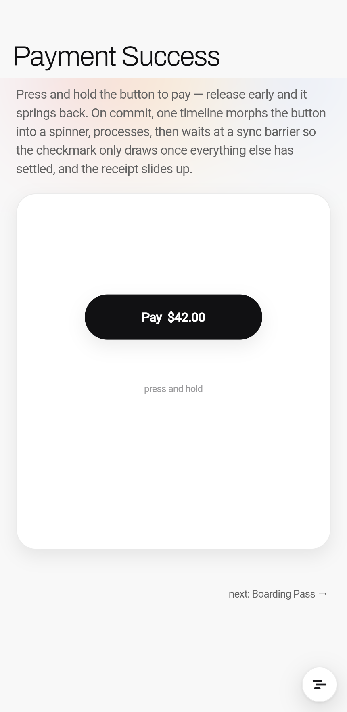
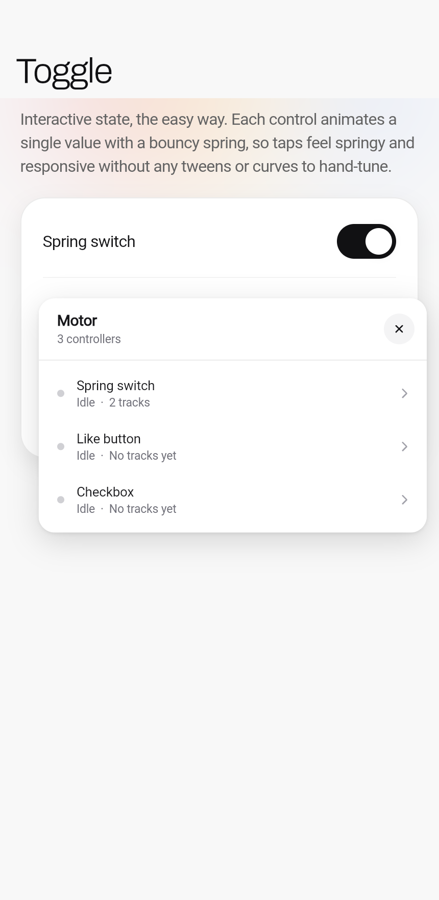
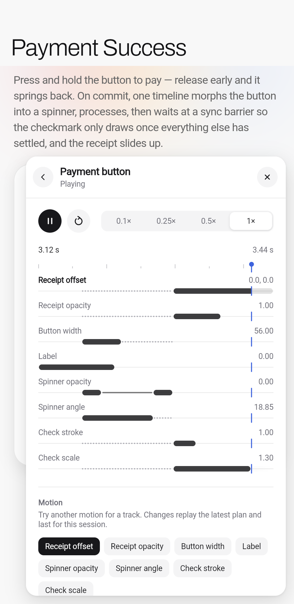
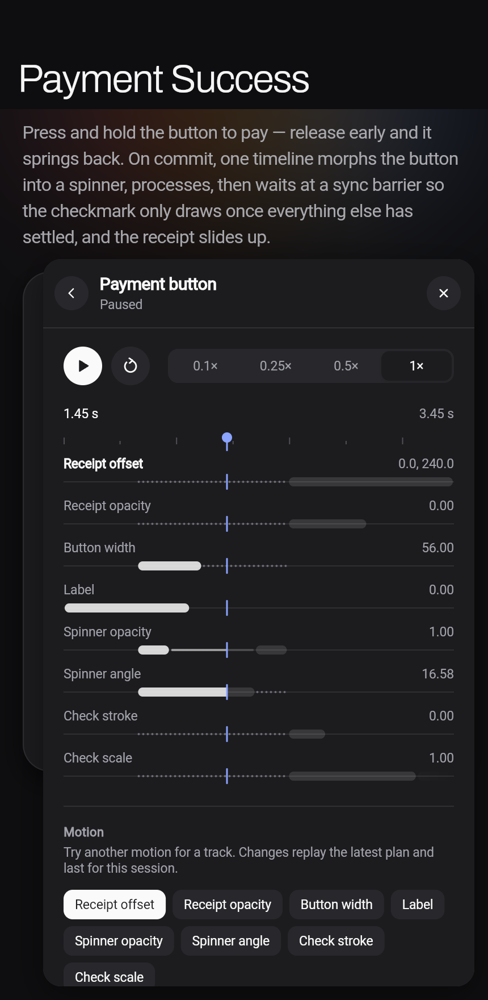

# Motor DevTools

An optional in-app inspector for [`motor`](https://pub.dev/packages/motor). A floating bubble sits above your app; tap it to inspect every live Motor controller, pause and scrub its timeline, slow it down, replay it, or test a different motion on any track.

| Bubble | Controllers | Controller | Scrubbing |
|---|---|---|---|
|  |  |  |  |

## Installation

Add `motor_devtools` alongside `motor`:

```sh
flutter pub add motor_devtools
```

`motor_devtools` is a pre-release and requires a Motor 2.0 pre-release.

Wrap your app with `MotorDevTools`:

```dart
import 'package:motor_devtools/motor_devtools.dart';

MaterialApp(
  builder: (context, child) => MotorDevTools(child: child!),
  home: const CheckoutPage(),
);
```

The tools are enabled in debug builds by default. Release builds render only `child` unless you pass `enabled: true` (see [Production builds](#production-builds) to strip the code completely).

`MotorDevTools` works around `MaterialApp`, `CupertinoApp`, or `WidgetsApp`. It brings its own neutral styling, follows the platform's light or dark mode, and has no Material or Cupertino dependencies.

## Naming controllers and tracks

The controller list shows each controller's `debugLabel`. In debug builds, unnamed controllers get an automatic fallback label — builders are named after the widget that built them (`CardStack · SingleMotionBuilder`), and standalone controllers after their call site (`CheckoutPage · controller`). Profile and release builds number unnamed controllers instead.

Every controller, builder, and track accepts a `debugLabel`:

```dart
final controller = TrackController(
  vsync: this,
  debugLabel: 'Checkout confirmation',
);

final cardScale = Track<double>(
  MotionConverter.single,
  initial: 0,
  debugLabel: 'Card scale',
);

SingleMotionBuilder(
  value: expanded ? 1 : 0,
  motion: const Motion.smoothSpring(),
  debugLabel: 'Sheet expansion',
  builder: (context, value, child) => ...,
);
```

`MotionController`, `SingleMotionController`, `BoundedMotionController`, `TrackBuilder`, `PhaseTrackBuilder`, `MotionBuilder`, `VelocityMotionBuilder`, and all widgets in `motor_widgets` accept `debugLabel` as well.

## Grouping and hiding controllers

Wrap a subtree in `MotorInspectionScope` to group or hide controllers created below it, or set `inspectionGroup` / `inspectable` on a controller directly:

```dart
import 'package:motor/inspection.dart';

// Group every button's press feedback into one row ("Button press ×9").
MotorInspectionScope(
  group: 'Button press',
  child: SingleMotionBuilder(value: pressed ? 0.96 : 1, …),
)

// Exclude a controller from the list.
_spinner = SingleMotionController(motion: spin, vsync: this)
  ..inspectable = false;
```

A controller's own `inspectable` and `inspectionGroup` take precedence over the nearest scope. Opening a group shows its members alongside shared controls for pause, replay, speed, and motion overrides (which also apply to members created later; motion overrides match tracks by `debugLabel` and fall back to all tracks when no labels match). Hidden controllers stay collapsed behind an "N hidden" row.

Without an explicit group, controllers with identical names collapse into an expandable row, and controllers that haven't played yet fold into an "N idle" row. Toggling "Hide idle" folds stopped controllers too until they play again, while keeping modified controllers visible.

## What you can do

- **Move the bubble:** Drag or fling it anywhere; it snaps to the nearest screen edge.
- **Browse every controller:** See whether each controller is playing, paused, or idle, and expand "N tracks" to view individual track lanes. Controllers with active overrides stay pinned in a Modified section, and controllers whose ticker is muted (for example by `TickerMode`) fold into a Muted section.
- **Pause, resume, and replay:** Play resumes from the paused or scrubbed point, or replays the latest plan once it has settled. Pausing and scrubbing apply while a controller's detail view is open; leaving the view resumes playback automatically.
- **Scrub timelines:** Drag or tap anywhere along a timeline. Each lane represents a track: bars are motions, thin lines are holds, and dots mark sync-barrier waits. Looping plans show one cycle at a time.
- **Slow down one controller:** Run a single controller at `0.1×`, `0.25×`, `0.5×`, or `1×` speed without changing Flutter's global `timeDilation`.
- **Swap and tune motions live:** Tap any track row to switch between its authored motion, your app's named motions, a spring, or a curve. Tune springs on a duration × bounce graph with a live preview, copy the resulting Dart code, and watch the latest plan replay immediately. Register your app's own motions by name:

  ```dart
  MotorDevTools(motions: {'Sheet': AppMotion.sheet}, child: app)
  ```

Speed and motion overrides persist for the current session. Modified controllers are marked in the list, counted on the bubble, and cleared by "Reset all" (or Reset on a controller's page), or whenever `MotorDevTools` is disabled or unmounted.

Pass a `MotorDevToolsController` if you want to open or close the panel from code.

## Embedding a timeline in your app

`MotorTimeline` renders a read-only timeline for a single controller, useful for demos and documentation. Lanes can name, color, and merge tracks, and inherit text styling from `DefaultTextStyle`:

```dart
MotorTimeline(
  controller: controller,
  lanes: [
    MotorTimelineLane('Card', [cardOffset], color: Colors.orange),
    MotorTimelineLane('Dots', [dotA, dotB]),
  ],
)
```

## Turning the tools off

Three controls, from coarsest to finest:

| Control | When off |
|---|---|
| `--dart-define=MOTOR_DEVTOOLS=false` (`kMotorDevTools`) | Strips the tools from the build. |
| `enabled:` (defaults to `kDebugMode`) | Disables tracking and clears any session overrides. |
| `visible:` | Hides the overlay while keeping tracking and overrides active. |

If you want to toggle the inspector from an in-app debug menu, keep `enabled` on and toggle `visible` so controller history, groups, and overrides are already populated when you open it:

```dart
MotorDevTools(
  enabled: kDebugMode || featureFlags.motionLab,
  visible: debugMenu.showMotorTools,
  child: app,
)
```

Hiding the overlay automatically resumes anything you paused. Note that while `enabled` is `true`, Motor records plan history and duration estimates for every controller in the app, even while the overlay is hidden.

## Production builds

`enabled` defaults to `kDebugMode`, so release builds do nothing unless you explicitly enable them (for example, behind a feature flag for internal testers). When `enabled` is `false`, `MotorDevTools` renders only its child and tracks nothing — controllers created while it was off won't appear if you turn it on later.

To strip the tools from a release build entirely, pass `--dart-define=MOTOR_DEVTOOLS=false`. A minimal web release build then grows by roughly 2 KB of JavaScript compared to not importing the package.

> **Note:** `debugLabel` values are stored as plain strings in your compiled binary — don't put sensitive data in them.

`motor_devtools` builds on Motor's `@experimental` inspection API (`package:motor/inspection.dart`), which may change in minor releases.
