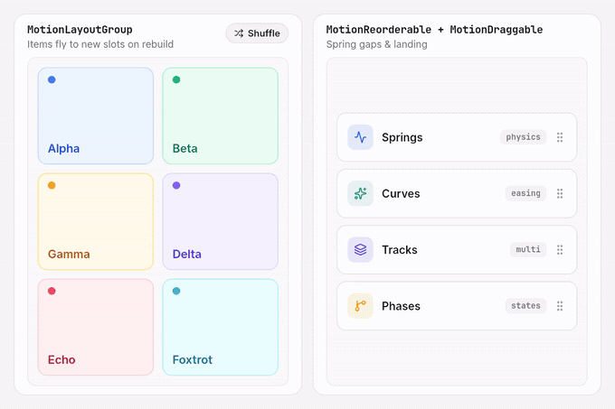

# Motor Widgets

Spring-driven versions of Flutter's implicit animation widgets, plus layout transitions and drag-and-drop, built on [Motor](../motor).

Flutter's `AnimatedContainer`, `AnimatedSwitcher`, `AnimatedSize`, and similar widgets run on an `AnimationController` with a fixed duration and curve. When a target value changes mid-flight, they start a new curve from zero velocity, which makes rapid updates feel stuttery.

The widgets in this package take a Motor `motion` instead. Whenever a target changes mid-flight, the animation redirects smoothly while keeping its current velocity.

> **See it in action:** [**Coil**](../coil) ([live catalog](https://whynotmake-it.github.io/rivership/#/coil)) is a full Flutter design system built on `motor` and `motor_widgets` — a great example of how spring-driven implicit widgets, size switchers, and layout transitions feel in a real app.

## Installation

```sh
flutter pub add motor_widgets
```

## Widget overview

| Flutter widget | Motor widget | Notes |
|---|---|---|
| `AnimatedOpacity` | `MotionOpacity` | Visible opacity stays clamped to `0..1` even if the spring overshoots. |
| `AnimatedAlign` | `MotionAlign` | `alignment`, `widthFactor`, and `heightFactor` each run on their own track. |
| `AnimatedPadding` | `MotionPadding` | Handles negative padding during spring overshoot via `PaddingExtended`. |
| `AnimatedPositioned` | `MotionPositioned` | Also includes `MotionPositioned.fromRect`. |
| `AnimatedScale` | `MotionScale` | |
| `AnimatedRotation` | `MotionRotation` | Takes `turns`, matching `AnimatedRotation`. |
| `AnimatedSlide` | `MotionSlide` | `offset` is a fraction of the child's size. |
| `AnimatedContainer` | `MotionContainer` | Runs one track per animated property (see below). |
| `AnimatedSize` | `MotionSize` | Springs when the child's content changes size; snaps when incoming constraints change. |
| `AnimatedSwitcher` | `MotionSwitcher` | Same `transitionBuilder` and `layoutBuilder` API, driven by a presence spring per child. |
| rivership `AnimatedSizeSwitcher` | `MotionSizeSwitcher` | Combines `MotionSwitcher` and `MotionSize`; new children fade in as width grows. |
| — | `MotionLayoutGroup`, `MotionLayoutItem` | Animates items to their new positions when a rebuild moves them. See [Layout groups](#layout-groups). |
| `Draggable`, `LongPressDraggable` | `MotionDraggable` | Drag feedback lands with a spring; works with standard `DragTarget`s. Use `start: .longPress` for long-press drags. See [Dragging](#dragging). |
| `ReorderableListView` | `MotionReorderable` | Reports where a drag would drop so your builder can render a gap or indicator in any list, grid, or sliver. See [Reordering](#reordering). |
| — | `MotionDragToScroll` | Auto-scrolls the scroll view below it while a drag hovers near an edge. See [Scrolling while dragging](#scrolling-while-dragging). |

Every widget accepts `motion` where Flutter's counterpart takes `duration` and `curve`, plus `tickerRate` and `debugLabel` so it appears by name in `motor_devtools`.

## Examples

### Implicit animations

```dart
MotionOpacity(
  opacity: visible ? 1 : 0,
  motion: const .smoothSpring(),
  child: const Text('Hello'),
)
```

```dart
MotionContainer(
  motion: const .bouncySpring(),
  width: expanded ? 240 : 120,
  padding: .all(expanded ? 24 : 12),
  decoration: BoxDecoration(
    color: expanded ? Colors.indigo : Colors.teal,
    borderRadius: .circular(expanded ? 32 : 12),
  ),
  child: const FlutterLogo(),
)
```

Each property animates on its own track, so changing a color won't disturb a width that is already in motion. `MotionContainer` animates `alignment`, `padding`, `margin`, `color`, `width`, `height`, `constraints`, `transform`, `transformAlignment`, and the `color` and `borderRadius` of a `BoxDecoration` in `decoration` or `foregroundDecoration`. Just like `AnimatedContainer`, a property transitioning from `null` to a value starts at that value immediately.

### Per-property motions

Widgets that animate multiple properties (`MotionContainer`, `MotionAlign`, `MotionPositioned`) run one Motor `Track` per property. Use `motion` as the default for all tracks and `motions` to override specific ones:

```dart
MotionContainer(
  motion: const .smoothSpring(),
  motions: {
    .color: const .snappySpring(),
    .padding: const .bouncySpring(),
  },
  color: selected ? Colors.indigo : Colors.grey,
  padding: .all(selected ? 24 : 12),
  child: child,
)
```

Track keys are typed per widget (`MotionContainerTrack`, `MotionAlignTrack`, `MotionPositionedTrack`), so dot-shorthand resolves them directly (`.color` is `MotionContainerTrack.color`). Motions compare by value, so rebuilding the map in `build` only restarts a track when its motion actually changes.

Single-value widgets (`MotionOpacity`, `MotionScale`, `MotionSlide`, and so on) only take `motion`.

### Size

```dart
MotionSize(
  motion: const .smoothSpring(),
  alignment: .topCenter,
  child: expanded ? const LongText() : const ShortText(),
)
```

### Switching children

```dart
MotionSwitcher(
  motion: const .smoothSpring(),
  exitMotion: const .snappySpring(duration: Duration(milliseconds: 300)),
  transitionBuilder: (child, animation) =>
      ScaleTransition(scale: animation, child: child),
  child: Text('$count', key: ValueKey(count)),
)
```

`MotionSwitcher` mirrors `AnimatedSwitcher`'s API, including `transitionBuilder` (defaulting to a fade) and `layoutBuilder`. A child with a different type or key triggers a switch.

Each child receives a presence `Animation<double>` driven by a `SingleMotionController`: `motion` brings new children from `0` to `1`, and `exitMotion` (often a tighter spring) takes leaving children back to `0`. Its status is `forward` while entering and `reverse` while leaving. If a child's key returns before it finishes exiting, it reverses course with its current velocity and preserves its state.

Note that the presence animation exposes the raw spring value and can overshoot `0..1`; transitions that require bounded values (like opacity) should clamp it or use a non-bouncing spring.

`MotionSizeSwitcher` wraps `MotionSwitcher` in a `MotionSize` so the container springs to the new child's size at the same time:

```dart
MotionSizeSwitcher(
  motion: const .smoothSpring(),
  child: loading ? const Spinner() : Text(result),
)
```

### Layout groups



`MotionLayoutGroup` animates each `MotionLayoutItem` from its previous painted position to its new position whenever a rebuild moves it. Identify each item with an `id`:

```dart
MotionLayoutGroup(
  child: Column(
    children: [
      for (final todo in todos)
        MotionLayoutItem(id: todo.id, child: TodoTile(todo)),
    ],
  ),
)
```

- Reorders, insertions, removals, and moves between containers in the same group (such as columns on a Kanban board) all animate automatically.
- Items are matched by `id` rather than widget identity, so lazy lists don't need keys or `findChildIndexCallback`.
- Position changes are checked only on rebuild, so scrolling never triggers spurious animations and idle frames do no extra work.
- If a neighbor grows on its own (such as a `MotionSize`), adjacent items follow it frame by frame rather than flying.
- Items that weren't on screen in the previous frame appear in place.
- Hit testing and semantics always stay at the item's layout position.

### Dragging

`MotionDraggable` wraps Flutter's `Draggable` with spring-animated pickup and landing. Plain `DragTarget`s receive the exact same data and callbacks as usual.

When a drag ends, the feedback looks for a landing site with its `id` (`data` by default) after the drop lays out:

- **Accepted and moved** (for example, to another column): the feedback springs to the item's new position.
- **Rejected or canceled:** it springs back to where the drag began.
- **Removed by the target:** it plays its exit animation at the drop point (shrinking and fading out by default).

Landing sites are `MotionLayoutItem`s and the draggable itself, and `id`s only need to be unique within a `MotionLayoutGroup`. An accepted drop lands in the target's group (a `MotionReorderable` uses its own), falling back to the innermost group under the pointer, and then to the source group.

The feedback stays in the `Overlay` only as long as necessary. Once it enters the destination item's visible bounds (typically on the frame after drop), it hands off to the item's own spring so the item finishes landing inside the widget tree with the feedback's velocity, scale, rotation, and opacity — properly clipped and layered. Control this with `handoff`: `.onEnter` (default), `.immediate`, or `.never`.

```dart
MotionDraggable<Task>(
  data: task,
  start: .longPress,
  // Collapse the source slot while dragging so a gap can open instead.
  childWhenDragging: (context, size) => const SizedBox.shrink(),
  transitions: (drag) => switch (drag.phase) {
    .dragging => [MotionDraggableTrack.scale([.to(1.05)])],
    _ => const [],
  },
  feedback: (context, drag) => Transform.rotate(
    angle: (drag.velocity.dx / 3000).clamp(-0.12, 0.12),
    child: TaskCard(task),
  ),
  child: TaskCard(task),
)
```

- `start: .longPress` starts dragging after a long press (like `LongPressDraggable`), triggering a selection haptic unless `hapticFeedbackOnStart` is `false`.
- Set `handleOnly: true` to restrict drag starts to a `MotionDragHandle` inside the child while still flying the whole draggable.
- Both `childWhenDragging` and `feedback` receive the child's measured size. By default, `childWhenDragging` keeps the child's space hidden, and `feedback` is laid out at `drag.size` (wrap it in an `Align` if it needs its own size).
- `transitions` returns Motor track animations for `scale`, `rotation`, and `opacity` per drag phase; omitted tracks spring back to rest.
- `drag.morph` springs from `0` to `1` while an accepted drop lands, letting `feedback` morph into the destination widget (for instance, a button turning into a card).
- Grabbing an item mid-landing (either on the feedback or on its slot) picks it right back up.

Differences from Flutter's `Draggable`:

- `onLanded` fires once the feedback finishes landing, even if the original draggable has already left the tree.
- `DragTargetDetails.offset` reports Flutter's standard unscaled top-left offset rather than the transformed feedback's bounds.

### Reordering

`MotionReorderable` tracks drags over its child and tells your builder where the drop would land (`drop.after` and `drop.before`). It doesn't impose a layout or wrap your items, so you decide whether to open a gap or draw an insertion line:

```dart
MotionReorderable<Task>(
  items: tasks,
  // `move.index` is already adjusted for removing the dragged item.
  onMove: (move) => setState(() {
    tasks
      ..remove(move.item)
      ..insert(move.index, move.item!);
  }),
  builder: (context, drop) => ListView(
    children: [
      for (final task in tasks) ...[
        if (drop?.before == task) const MotionDropGap(child: TaskSlot()),
        MotionReorderableItem(
          item: task,
          child: MotionDraggable<Task>(
            data: task,
            childWhenDragging: (context, size) => const SizedBox.shrink(),
            child: TaskTile(task),
          ),
        ),
      ],
      if (drop != null && drop.before == null)
        const MotionDropGap(child: TaskSlot()),
    ],
  ),
)
```

- Each `MotionReorderableItem` is a `MotionLayoutItem`, so neighboring items spring out of the way when the drop shifts. `MotionReorderable` creates its own `MotionLayoutGroup` unless one already exists above it.
- Insert a `MotionDropGap` to open space for the landing feedback. If you prefer an insertion line without shifting items, draw it on the neighboring items and keep the default `childWhenDragging`.
- `onMove` handles intra-list reorders, drops from other reorderables, and screen-reader moves. Use `onWillAccept` to accept other data types (such as dragging a button to create a new item).
- Drop placement is computed from item geometry (using the pointer, or the feedback center with `point: .feedbackCenter`) with a small deadband to prevent flicker, so lists, grids, and wraps all work the same way.
- The entire child area accepts drags, including headers; dragging past the first or last item targets the nearest end.
- By default, the drop indicator stays active if the pointer leaves the reorderable so surrounding layout doesn't jump, and releasing outside still commits the drop. Set `keepsDropOnLeave: false` to clear it on leave.
- If `onMove` returns a `Future`, the drop stays pending (`drop.pending`) and the feedback waits over the gap. If the future throws or finishes without adding the item to `items`, the feedback springs back.
- Use `MotionReorderable.sliver` for slivers inside a `CustomScrollView` (must be wrapped in a `MotionLayoutGroup`).

### Scrolling while dragging

`MotionDragToScroll` scrolls the nearest scroll view beneath it when a drag nears an edge. Speed increases as the pointer approaches the edge, eases smoothly via a spring, and continues while the pointer is held still.

- Wrap each scrollable that should auto-scroll with its own `MotionDragToScroll`. On a board, put one around the horizontal scroll view and one around each vertical column; when two share an axis, the inner one scrolls first.
- It only ticks frames while a drag is inside an edge band or while its scroll speed is springing back to zero.
- `MotionDraggable`s are tracked anywhere on screen. With `outside: true` (the default), a scroll view that is already scrolling keeps going if the pointer moves past its edge, while drags starting elsewhere won't trigger it.
- Standard `Draggable`s are tracked while over the widget (or passed through from a nested `MotionReorderable`).

## Differences from Flutter's implicit widgets

- **No reverse durations or curves:** Springs don't have a separate reverse leg, so `MotionSize` has no `reverseDuration`, and the switchers use `exitMotion` (defaulting to `motion`) instead of `reverseDuration`, `switchInCurve`, and `switchOutCurve`.
- **`MotionSize` distinguishes content changes from constraint changes:** When the child's content resizes, `MotionSize` springs to the new size. When incoming constraints change (such as resizing the window) or the ambient text scale changes, it snaps immediately and cancels any running spring. Constraint changes that don't affect the child's size leave a running spring alone.
- **Exiting children are non-interactive:** In `MotionSwitcher` and `MotionSizeSwitcher`, leaving children ignore taps, focus, and semantics while preserving their state. If a leaving child's key becomes active again mid-exit, it immediately becomes interactive again.
- **`MotionSizeSwitcher` manages its own layout:** It doesn't expose a `layoutBuilder`. While growing in width, it fades the incoming child in as space opens so clipped content doesn't pop in; shrinking or height-only growth skips this fade.
- **`MotionSizeSwitcher(immediateResize: true)` prevents text reflow:** Exiting children keep the switcher's incoming constraints (aligned by `alignment` and clipped to the new bounds) so wrapping text doesn't reflow while fading out.
- **`MotionSizeSwitcher.sizeMotion`:** Lets you use a separate spring for the container resize (for example, a spatial spring for size while children fade with `motion`).
- **Properties in `MotionContainer` that update immediately:** `BoxDecoration` borders, shadows, gradients, and images; non-`BoxDecoration` decorations; and unbounded constraints. As in `AnimatedContainer`, animating a `transform` drops perspective and skew during the transition.
- **Shortest-path rotation in `MotionContainer.transform`:** Rotations always take the shortest path (at most half a turn), avoiding `Matrix4.decompose` sign flips past ~240°. Use `MotionRotation` for multi-turn spins.
- **Directional values resolve before animating:** `MotionAlign`, `MotionContainer`, and `MotionPadding` resolve `AlignmentDirectional` and `EdgeInsetsDirectional` against the ambient `Directionality` before animating; changing text direction jumps immediately.
- **Not ported:** `AnimatedPositionedDirectional`, `AnimatedCrossFade` (use `MotionSwitcher`), `AnimatedPhysicalModel`, `AnimatedDefaultTextStyle`, and `AnimatedFractionallySizedBox`.

## Reduced motion

Every widget uses whichever `motion` you pass. To honor reduced motion, substitute `Motion.instant()` (or a quick non-bouncing spring) when `MediaQuery.disableAnimationsOf(context)` is `true` — ideally in one place inside your design system's motion tokens.
