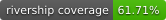

# Rivership

[](https://pub.dev/packages/rivership)
[](./test/)
[![lints by lintervention][lintervention_badge]][lintervention_link]
[](https://bsky.app/profile/i.madethese.works)

Rivership is a set of opinionated tools that will get you shipping your Flutter app in no time if you are using [`riverpod`](https://pub.dev/packages/hooks_riverpod) and [`flutter_hooks`](https://pub.dev/packages/flutter_hooks).

## Installation

```sh
flutter pub add rivership
```

## What's included

Rivership includes a diverse set of hooks, type extensions, and utilities that help you build your app faster. Everything is documented in code, and here is a quick overview of the highlights:

### Hooks

#### `useMotion`
A hook that animates a value using a `Motion`.

```dart
final double value = useSingleMotion(
    value: 100,
    from: 0,
    motion: const CupertinoMotion(),
);

final Offset offset = useOffsetMotion(
    value: const Offset(100, 100),
    motion: const CupertinoMotion.bouncy(),
);
```

Whenever the `value` changes, the hook will animate to the new value using the provided `motion`.

See the [motor docs](https://pub.dev/packages/motor) for more information on the different motions.

#### `useTweenAnimation`
A super helpful hook that lets you use the power of `TweenAnimationBuilder` without any nesting.

```dart
final bool isActive;

Widget build(BuildContext context, WidgetRef ref) {
    // This will start at 0 and animate to 1 when isActive is true.
    // It will also keep animating each transition after that.
    final scale = useTweenAnimation<double>(
        Tween(begin: 0.0, end: isActive ? 1.0 : 0.0),
    );
    return Transform.scale(
        scale: scale,
        child: const Text('Hello World'),
    );
}

```

For even terser code, you can use the `useTweenedValue` convenience hook, that will initialize the `Tween` for you:

```dart
final bool isActive;

Widget build(BuildContext context, WidgetRef ref) {
    // This will automatically animate each transition when changing isActive.
    final scale = useTweenedValue<double>(isActive ? 1.0 : 0.0);
    return Transform.scale(
        scale: scale,
        child: const Text('Hello World'),
    );
}    
```

#### `useDelayed`
A hook that will help you model delayed UI changes in a declarative way.
This can be super helpful for all kinds of animations, popovers, toasts, etc.

Let's say for example that we want to color a counter text red for 1 second every time its value changes.

```dart
final int value;

Widget build(BuildContext context, WidgetRef ref) {
    // This will restart with true every time value changes.
    final isRed = useDelayed(
        delay: const Duration(seconds: 1),
        before: true,
        after: false,
        keys: [value],
    );
    return Text(
        'Value: $value', 
        style: TextStyle(color: isRed ? Colors.red : Colors.black),
    );
}
```

If you don't want the text to start red, but instead only color it when `value` changes for the first time, you can set `startDone` to `true`:

```dart
final isRed = useDelayed(
    delay: const Duration(seconds: 1),
    before: true,
    after: false,
    startDone: true,
    keys: [value],
);
```


#### `usePage`
A hook that will return the current page from a given `PageController` which can help you achieve complex animations and transitions in `PageView`s.

```dart
Widget build(BuildContext context, WidgetRef ref) {
    final pageController = usePageController();
    final page = usePage(pageController);
    return Text('Current page: $page');
}
```

> [!WARNING]
> **Be mindful of rebuilds**
> Similar to hooks like `useAnimation`, this hook triggers a rebuild on every frame while the page is being dragged or animating.
> Call it from a widget that is cheap to rebuild — ideally a leaf of your widget tree.

### Design Utilities

Rivership includes a few helper tools for working with colors and other UI properties.

#### `SimpleWidgetStates`
A subclass of `WidgetStateProperty` that purposefully trades flexibility for simplicity.
Define states like this:

```dart
return TextButton(
    style: ButtonStyle(
        foregroundColor: SimpleWidgetStates.from(
            normal: Colors.blue,
            pressed: Colors.blue[800],
            disabled: Colors.grey,
        ),
    ),
    child: Text("Button"),
    onPressed: () {},
);
```

The values you don't pass fall back to those you did pass, so you only need to define the states you care about.

[lintervention_link]: https://github.com/whynotmake-it/lintervention
[lintervention_badge]: https://img.shields.io/badge/lints_by-lintervention-3A5A40