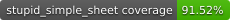

<p align="center">
  
</p>

# Stupid Simple Sheet

[](https://pub.dev/packages/stupid_simple_sheet)
[](./test/)
[![lints by lintervention][lintervention_badge]][lintervention_link]
[](https://bsky.app/profile/i.madethese.works)

The only Flutter sheet that **transitions directly between scrolling content and sheet dragging** — with real spring physics.

Put a `ListView`, `CustomScrollView`, `PageView`, or any scrollable inside the sheet. When the user scrolls to the edge, the gesture hands off to the sheet drag automatically. You don't need to worry about stuff like `DraggableScrollableSheet`. Just smooth, physics-driven motion powered by [motor](https://pub.dev/packages/motor).

## Try it out

[Open Example](https://whynotmake-it.github.io/rivership/#/stupid_simple_sheet)

## Installation

```sh
flutter pub add stupid_simple_sheet
```

## Quick start

Push a sheet like you push any route:

```dart
Navigator.of(context).push(
  StupidSimpleGlassSheetRoute(
    child: YourContent(),
  ),
);
```

That gives you an iOS 26 glass sheet with spring physics and scroll-to-drag handoff out of the box.

## Important

The sheet relies on the default scroll behavior to detect scroll boundaries and transition between scrolling and dragging. If content inside the sheet overrides its `ScrollBehavior`, wrap that behavior in `ScrollDragBehavior` (exported by this package) so the handoff keeps working:

```dart
ScrollConfiguration(
  behavior: ScrollDragBehavior(
    parent: const ScrollBehavior().copyWith(scrollbars: false),
  ),
  child: YourScrollable(),
)
```

## Cookbook

Each recipe below is a self-contained pattern you can copy into your project. Full runnable examples live in the [`example/`](./example/lib/) directory.

---

### Glass sheet (iOS 26)

The modern iOS sheet style with liquid glass blur. Stacked glass sheets coordinate automatically — only the first sheet blurs the backdrop.

> [Full example](./example/lib/capabilities/route_capabilities.dart)

 

```dart
Navigator.of(context).push(
  StupidSimpleGlassSheetRoute(
    child: YourContent(),
  ),
);
```

---

### Cupertino sheet

The classic iOS modal sheet with push-back transitions on the route behind.

> [Full example](./example/lib/capabilities/route_capabilities.dart)


```dart
Navigator.of(context).push(
  StupidSimpleCupertinoSheetRoute(
    child: CupertinoPageScaffold(
      child: CustomScrollView(
        slivers: [
          CupertinoSliverNavigationBar(
            largeTitle: Text('Sheet'),
            leading: CupertinoButton(
              padding: EdgeInsets.zero,
              child: Text('Close'),
              onPressed: () => Navigator.of(context).pop(),
            ),
          ),
          SliverList(
            delegate: SliverChildBuilderDelegate(
              (context, index) => CupertinoListTile(
                title: Text('Item #$index'),
              ),
              childCount: 50,
            ),
          ),
        ],
      ),
    ),
  ),
);
```

---

### Customizing preset routes

Both `StupidSimpleCupertinoSheetRoute` and `StupidSimpleGlassSheetRoute` accept
`shape` and `backgroundColor` to tweak their appearance without building a
custom route:

```dart
StupidSimpleCupertinoSheetRoute(
  backgroundColor: CupertinoColors.systemGroupedBackground,
  shape: RoundedRectangleBorder(
    borderRadius: BorderRadius.vertical(top: Radius.circular(20)),
  ),
  child: YourContent(),
)
```

---

### Non-draggable sheet

A sheet that can only be closed programmatically. Useful for confirmation dialogs or critical flows.

> [Full example](./example/lib/capabilities/dismissal_capabilities.dart)

```dart
Navigator.of(context).push(
  StupidSimpleCupertinoSheetRoute(
    draggable: false,
    child: YourContent(), // Must include a close button
  ),
);
```

---

### Preventing dismiss with PopScope

Wrap content in Flutter's `PopScope` to prevent drag-to-dismiss while still
allowing the user to drag the sheet between snap points. The sheet automatically
applies rubber-band resistance when dragged below the lowest snap.

```dart
Navigator.of(context).push(
  StupidSimpleCupertinoSheetRoute(
    snappingConfig: SheetSnappingConfig([0.5, 1.0]),
    child: PopScope(
      canPop: false, // prevents drag-to-dismiss
      child: YourContent(),
    ),
  ),
);
```

> This differs from `draggable: false`, which disables all drag gestures
> entirely. `PopScope` only prevents the dismiss — the sheet is still
> draggable between its snap points.

---

### Drag handoff

`dragHandoff` decides when scrolling content hands its gesture to the sheet.
`SheetDragHandoff.gestureStart` (the default, like iOS) lets the sheet take over
only if the content was already at its top edge when the gesture began.
`SheetDragHandoff.continuous` also lets the sheet take over when the same
gesture scrolls the content to its top edge.

```dart
Navigator.of(context).push(
  StupidSimpleCupertinoSheetRoute(
    dragHandoff: SheetDragHandoff.continuous,
    child: YourContent(),
  ),
);
```

---

### Content with its own drags

The sheet drag beats a descendant pan, so a map or canvas inside a sheet would
lose its drags to it. Wrap such content in `ExcludeScrollDrag`; pass `axes` to
exclude only some directions.

```dart
ExcludeScrollDrag(child: MapView())
```

---

### Snapping sheet (multi-stop)

A sheet that snaps to specific positions. Combine `SheetSnappingConfig` with
`initialSnap` to control where the sheet opens.

> [Full example](./example/lib/capabilities/snapping_capabilities.dart)

```dart
Navigator.of(context).push(
  StupidSimpleCupertinoSheetRoute(
    snappingConfig: SheetSnappingConfig(
      [0.5, 1.0], // half-open and full
      initialSnap: 0.5,
    ),
    child: YourContent(),
  ),
);
```

If you are migrating from a pre-`1.0.0-dev.1` release and need to preserve
its snap response, opt into the deprecated compatibility physics:

```dart
SheetSnappingConfig(
  [0.5, 1.0],
  physics: LegacySnapPhysics(),
);
```

New code should use the default `FlingSnapPhysics` or opt into
`FrictionSnapPhysics`.

You can dynamically change snapping at runtime from inside the sheet:

```dart
final controller = StupidSimpleSheetController.maybeOf(context);
// Remove intermediate snaps, animate to comply
controller?.overrideSnappingConfig(
  SheetSnappingConfig.full,
  animateToComply: true,
);
// Reset back to original config
controller?.overrideSnappingConfig(null);
```

---

### Sheet with a persistent footer (shrink dismissal)

Use `DismissalMode.shrink` to shrink the sheet's height instead of sliding it
down. `ShrinkTransition` tightens the child's `maxHeight` constraint as the
sheet closes, so flexible content like `Expanded(child: ListView(...))` shrinks
first while fixed headers and footers stay visible — useful for share sheets,
action bars, or confirmation buttons.

> [Full example](./example/lib/capabilities/dismissal_capabilities.dart)


```dart
Navigator.of(context).push(
  StupidSimpleCupertinoSheetRoute(
    dismissalMode: DismissalMode.shrink,
    snappingConfig: SheetSnappingConfig([0.5, 1.0]),
    child: SafeArea(
      child: Column(
        children: [
          // Header
          Text('Share with...'),

          // Scrollable content — shrinks away first
          Expanded(child: ListView(...)),

          // Footer — stays visible while the list shrinks
          Row(
            children: [
              Expanded(child: CupertinoButton(child: Text('Copy Link'), ...)),
              Expanded(child: CupertinoButton.filled(child: Text('Send'), ...)),
            ],
          ),
        ],
      ),
    ),
  ),
);
```

**How it works:** With `DismissalMode.slide` (the default), the entire sheet
translates downward. With `DismissalMode.shrink`, `ShrinkTransition` reduces the
child's `maxHeight` constraint down to its minimum intrinsic height, so flexible
or scrollable children shrink while fixed headers and footers stay visible. Once
the target height falls below the child's minimum intrinsic height, the child is
laid out at its minimum height and clipped at the bottom.

---

### Resizing sheet (content-sized)

A small floating card that sizes to fit its content. Use
`originateAboveBottomViewInset` to keep the sheet above the keyboard at all times.

> [Full example](./example/lib/capabilities/size_capabilities.dart)


```dart
Navigator.of(context).push(
  StupidSimpleSheetRoute(
    originateAboveBottomViewInset: true,
    motion: CupertinoMotion.smooth(),
    child: SafeArea(
      child: Card(
        margin: EdgeInsets.all(16),
        child: Column(
          mainAxisSize: MainAxisSize.min, // size to content
          children: [
            CupertinoTextField(placeholder: 'Type something...'),
            // Content can grow dynamically
          ],
        ),
      ),
    ),
  ),
);
```

Note: `StupidSimpleSheetRoute` provides **no background, shape, or SafeArea by
default** — you style everything yourself. This is what lets you build floating
cards, full-bleed layouts, or anything else.

---

### Unstyled sheet (`StupidSimpleSheetRoute`)

`StupidSimpleSheetRoute` is the bare-bones base. It provides no background,
shape, or safe area, so you can style the sheet however you want. Wrap content in
`SheetBackground` if you want the standard look:

```dart
Navigator.of(context).push(
  StupidSimpleSheetRoute(
    child: SafeArea(
      bottom: false,
      left: false,
      right: false,
      child: SheetBackground(
        child: YourContent(),
      ),
    ),
  ),
);
```

`SheetBackground` gives you:
- Rounded superellipse shape (24px radius)
- Theme surface color
- Anti-aliased clipping
- Automatic background extension to cover overdrag

Customize it:

```dart
SheetBackground(
  backgroundColor: Colors.blue.shade50,
  shape: RoundedRectangleBorder(
    borderRadius: BorderRadius.vertical(top: Radius.circular(16)),
  ),
  child: YourContent(),
)
```

---

### Programmatic control

Use `StupidSimpleSheetController` from inside the sheet to animate position or
change snapping:

```dart
Builder(
  builder: (context) {
    final controller = StupidSimpleSheetController.maybeOf<void>(context);

    return ElevatedButton(
      onPressed: () => controller?.animateToRelative(0.5),
      child: Text('Half Open'),
    );
  },
)
```

| Method                                              | Description                                                                                 |
| --------------------------------------------------- | ------------------------------------------------------------------------------------------- |
| `animateToRelative(position, {snap})`               | Animate to a position between 0.0-1.0. Pass `snap: true` to snap to the nearest snap point. |
| `overrideSnappingConfig(config, {animateToComply})` | Change or reset (`null`) snapping at runtime.                                               |

To **close** the sheet, use `Navigator.pop(context)`.

---

### Background snapshotting

Rasterize the route behind the sheet into a GPU texture for smoother transitions:

```dart
StupidSimpleCupertinoSheetRoute(
  backgroundSnapshotMode: RouteSnapshotMode.openAndForward,
  child: YourContent(),
)
```

| Mode             | Snapshots when                                                                             |
| ---------------- | ------------------------------------------------------------------------------------------ |
| `never`          | Never (default). Background is always painted live.                                        |
| `always`         | Entire lifetime. Best for static backgrounds.                                              |
| `animating`      | During animations and drags only. Live when settled.                                       |
| `settled`        | When settled only. Live during animations.                                                 |
| `openAndForward` | During the opening animation and while settled at max snap. Live during drags and closing. |

---

### Custom routes

To customize route behavior directly, create a custom route using `StupidSimpleSheetTransitionMixin`:

```dart
class MySheetRoute<T> extends PopupRoute<T>
    with StupidSimpleSheetTransitionMixin<T> {
  MySheetRoute({required this.child});

  final Widget child;

  @override
  final Motion motion = CupertinoMotion.smooth(snapToEnd: true);

  @override
  final SheetSnappingConfig snappingConfig = SheetSnappingConfig.full;

  @override
  Widget buildContent(BuildContext context) => child;

  @override
  double get overshootResistance => 50;

  @override
  Color? get barrierColor => Colors.black26;

  @override
  bool get barrierDismissible => true;

  @override
  String? get barrierLabel => null;
}
```

---

[lintervention_link]: https://github.com/whynotmake-it/lintervention
[lintervention_badge]: https://img.shields.io/badge/lints_by-lintervention-3A5A40
