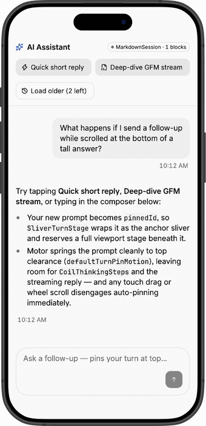
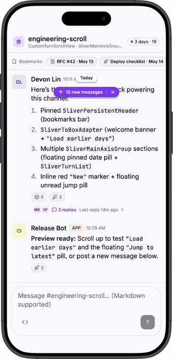

# turns

Turn-anchored scroll primitives and incremental streaming markdown parsing for
Flutter AI chat transcripts, streaming timelines, and messaging feeds.

## Demos

<table>
  <tr>
    <td align="center" width="33%">
      <br />
      <b>AI Assistant</b><br />
      <code>TurnScrollView</code> + <code>SliverTurnStage</code> pins the sent
      prompt to the top while GFM markdown streams token-by-token, with
      zero-fight disengagement on user scroll.
    </td>
    <td align="center" width="33%">
      <br />
      <b>WhatsApp Sections (2,400 msgs)</b><br />
      <code>TurnScrollView.sectioned</code> on a 2,400-message O(1) timeline
      with floating push-up date pills, <code>0.0px</code>-shift prepend
      pagination, and spring-driven jump to offscreen quoted replies.
    </td>
    <td align="center" width="33%">
      <br />
      <b>Slack Slivers</b><br />
      <code>CustomTurnScrollView</code> composing pinned bookmarks,
      <code>SliverMainAxisGroup</code> + <code>SliverTurnList</code> day
      sections, transparent floating date pills, and an unread jump pill landing
      on the inline <code>New</code> divider.
    </td>
  </tr>
</table>

## Features

- **Bidirectional `Viewport(center:)` timelines (`TurnScrollView`)**:
  - **O(1) open** at the bottom or at any `initialItemId` without laying out earlier items.
  - **`0.0px`-shift prepend pagination** with preserved child widget `State`.
  - **Single-pass `SliverTurnStage` turn pinning**: pass `pinnedId` to reserve a viewport stage for the active prompt so `maxScrollExtent` stays flat while tokens stream.
  - **Zero-fight user control**: any drag, wheel, or trackpad gesture disengages auto-pinning immediately.
  - **Synchronous keyboard-inset anchoring**: shifts scroll offset by the exact bottom-edge delta during layout without a 1-frame flash.
- **Typed section headers (`TurnScrollView.sectioned`)**: inline or sticky push-up headers with automatic `alignment: 0` clearance and pointer pass-through (`stickyHeaderIgnoresPointer`).
- **Composable native slivers (`CustomTurnScrollView` + `SliverTurnList`)**: mix `SliverAppBar`, `SliverPersistentHeader`, `SliverMainAxisGroup`, and multiple `SliverTurnList` sections while keeping Motor-driven offscreen `scrollTo()` and `jumpToBottom()`.
- **Pure-Dart streaming markdown (`MarkdownSession`)**: freezes settled top-level blocks by identity and repairs unfinished inline syntax (`completeMarkdown`) while tokens arrive, plus pure-Dart LaTeX math syntaxes (`latexMathSyntaxes`).

## Quick Start

### 1. AI Assistant Turn Pinning

```dart
final controller = TurnScrollController();

TurnScrollView<Object>(
  controller: controller,
  itemCount: messages.length,
  itemId: (i) => messages[i].id,
  pinnedId: activeUserMessageId,
  padding: EdgeInsets.fromLTRB(16, 16, 16, composerHeight + 24),
  itemBuilder: (context, i) => buildMessage(messages[i]),
);
```

React to bottom distance or active pinning without extra scroll listeners:

```dart
ValueListenableBuilder<bool>(
  valueListenable: controller.isAwayFromBottom,
  builder: (context, isAway, _) => isAway
      ? JumpToBottomButton(onPressed: controller.jumpToBottom)
      : const SizedBox.shrink(),
);
```

### 2. Sectioned Messaging Feed & Top Pagination

```dart
NotificationListener<TurnScrollNotification>(
  onNotification: (notification) {
    if (!notification.isProgrammatic && notification.leadingExtent < 160) {
      loadOlderPage(); // Prepends with 0.0px shift and preserved child State
    }
    return false;
  },
  child: TurnScrollView<DateTime>.sectioned(
    controller: controller,
    itemCount: messages.length,
    itemId: (i) => messages[i].id,
    sectionId: (i) => messages[i].day,
    initialItemId: deepLinkedMessageId, // O(1) open + frame-1 sticky header
    sectionHeaderBuilder: (context, day) => DatePill(day),
    itemBuilder: (context, i) => MessageBubble(messages[i]),
  ),
);
```

`scrollTo` and `jumpToBottom` return `Future<bool>` (`true` on clean arrival,
`false` if interrupted by a user drag or superseded):

```dart
final arrived = await controller.scrollTo(quotedMessageId, alignment: 0.25);
if (arrived && mounted) {
  highlightMessage(quotedMessageId);
}
```

### 3. Composing Native Flutter Slivers

```dart
CustomTurnScrollView(
  controller: controller,
  slivers: [
    SliverPersistentHeader(pinned: true, delegate: bookmarksDelegate),
    for (final day in days)
      SliverMainAxisGroup(
        key: ValueKey('day:${day.id}'),
        slivers: [
          SliverPersistentHeader(pinned: true, delegate: dayHeader(day)),
          SliverTurnList(
            key: ValueKey('list:${day.id}'),
            itemCount: day.messages.length,
            itemId: (i) => day.messages[i].id,
            itemBuilder: (context, i) => SlackRow(day.messages[i]),
          ),
        ],
      ),
  ],
);
```

### 4. Incremental Streaming Markdown

```dart
final session = MarkdownSession();

// As each chunk arrives:
final doc = session.update(streamedText, streaming: true);

// doc.stable segments keep identical instances across updates (cache widgets by segment.id).
// doc.pending is the only tail segment reparsed, with unfinished **bold**, `code`,
// and [links](url temporarily closed via completeMarkdown().
```

## Libraries

- `package:turns/turns.dart` — full public API (scroll + markdown).
- `package:turns/scroll.dart` — `TurnScrollView`, `TurnScrollView.sectioned`,
  `CustomTurnScrollView`, `SliverTurnList`, `SliverTurnStage`,
  `TurnScrollController`, `TurnScrollNotification`, `TurnScrollScope`,
  `TurnScrollItem`.
- `package:turns/markdown.dart` — `MarkdownSession`, `MarkdownDocument`,
  `MarkdownSegment`, `parseMarkdown`, `completeMarkdown`, `markdownBoundary`,
  and pure-Dart LaTeX math inline syntaxes (`latexMathSyntaxes`,
  `DisplayMathSyntax`, `InlineMathSyntax`).

## Running the Example Gallery

```sh
cd packages/turns/example
flutter run
```
