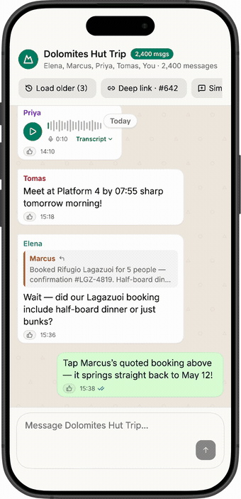
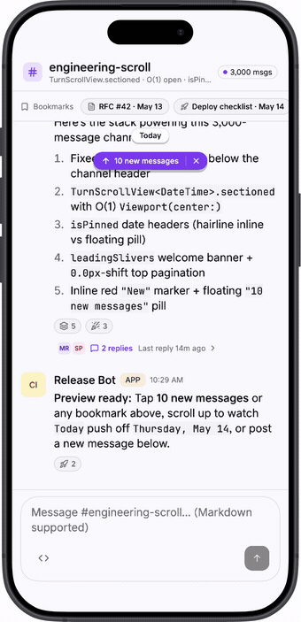

# turns

Turn-anchored scroll primitives and incremental streaming markdown parsing for
Flutter AI chat transcripts, streaming timelines, and messaging feeds.

## Demos

<table>
  <tr>
    <td align="center" width="33%">
      <br />
      <b>AI Assistant</b><br />
      <code>TurnScrollView</code> + <code>SliverTurnStage</code> pins the sent
      prompt to the top while GFM markdown streams token-by-token, with
      zero-fight disengagement on user scroll.
    </td>
    <td align="center" width="33%">
      <br />
      <b>WhatsApp Sections (2,400 msgs)</b><br />
      <code>TurnScrollView.sectioned</code> on a 2,400-message O(1) timeline
      with floating push-up date pills, <code>0.0px</code>-shift prepend
      pagination, and spring-driven jump to offscreen quoted replies.
    </td>
    <td align="center" width="33%">
      <br />
      <b>Slack Channel (3,000 msgs)</b><br />
      <code>TurnScrollView.sectioned</code> across 3,000 messages using
      <code>isPinned</code> to switch between inline date hairlines and
      transparent floating pills, <code>0.0px</code>-shift prepend pagination,
      and an unread jump pill landing on the inline <code>New</code> divider.
    </td>
  </tr>
</table>

## Features

- **Bidirectional `Viewport(center:)` timelines (`TurnScrollView`)**:
  - **O(1) open** at the bottom or at any `initialItemId` without laying out earlier items.
  - **`0.0px`-shift prepend pagination** with preserved child widget `State`.
  - **Single-pass `SliverTurnStage` turn pinning**: pass `pinnedId` to reserve a viewport stage for the active prompt so `maxScrollExtent` stays flat while tokens stream.
  - **Zero-fight user control**: any drag, wheel, or trackpad gesture disengages auto-pinning immediately.
  - **Synchronous keyboard-inset anchoring**: shifts scroll offset by the exact bottom-edge delta during layout without a 1-frame flash.
- **Typed section headers (`TurnScrollView.sectioned`)**: inline or sticky push-up headers with an `isPinned` flag (hairline divider inline vs elevated floating pill when pinned), automatic `alignment: 0` clearance, and pointer pass-through (`stickyHeaderIgnoresPointer`).
- **Composable native slivers (`CustomTurnScrollView` + `SliverTurnList`)**: escape hatch for bounded feeds that need arbitrary Flutter slivers (`SliverAppBar`, `SliverGrid`, stacked `SliverPersistentHeader`s) while keeping Motor-driven offscreen `scrollTo()` and `jumpToBottom()`.
- **Pure-Dart streaming markdown (`MarkdownSession`)**: freezes settled top-level blocks by identity and repairs unfinished inline syntax (`completeMarkdown`) while tokens arrive, plus pure-Dart LaTeX math syntaxes (`latexMathSyntaxes`).

## Choosing `TurnScrollView` vs `CustomTurnScrollView`

Most production chat, messaging, and AI apps — including Slack- and
WhatsApp-scale channels with thousands of messages and sticky date pills —
should use **`TurnScrollView`** or **`TurnScrollView.sectioned`**. Reach for
**`CustomTurnScrollView` + `SliverTurnList`** only for bounded or
moderate-length feeds (like the **Onboarding** demo in `example/`) where you
genuinely need arbitrary Flutter slivers such as a collapsing `SliverAppBar` or
an inline `SliverGrid`.

| | `TurnScrollView` / `TurnScrollView.sectioned` | `CustomTurnScrollView` + `SliverTurnList` |
| --- | --- | --- |
| **Role** | **Default choice for almost all chat, messaging, and AI timelines** — including Slack/WhatsApp-scale 10,000+ message channels with sticky date headers. | **Escape hatch for bounded / moderate-length feeds** (onboarding flows, issue/ticket threads, detail views, media-rich feeds) that genuinely need arbitrary Flutter slivers. |
| **Viewport model** | Bidirectional `Viewport(center:)` | Forward-only `Viewport` (walks from sliver `0`) |
| **O(1) open at bottom or `initialItemId`** | **Yes** — opens at message `#10,000` without laying out earlier items. | **No** — walks forward from sliver `0` to reach deep targets. |
| **Prepend pagination above viewport** | **`0.0px` shift** with preserved child widget `State`, plus bidirectional `TurnScrollNotification`. | **Shifts scroll position** when prepending above the viewport. |
| **Sticky section headers** | Built-in via `TurnScrollView.sectioned` with `isPinned` styling and smooth push-up across the center seam. | Manual (`SliverMainAxisGroup` + `SliverPersistentHeader`). |
| **Arbitrary mixed slivers** | `leadingSlivers` above item `0` and `tailSliver` below the last item — **no collapsing `SliverAppBar` or `SliverGrid` inside the list**. | **Full Flutter sliver composition** (`SliverAppBar`, `SliverGrid`, stacked `SliverPersistentHeader`s). |

## Quick Start

### 1. AI Assistant Turn Pinning

```dart
final controller = TurnScrollController();

TurnScrollView<Object>(
  controller: controller,
  itemCount: messages.length,
  itemId: (i) => messages[i].id,
  pinnedId: activeUserMessageId,
  padding: EdgeInsets.fromLTRB(16, 16, 16, composerHeight + 24),
  itemBuilder: (context, i) => buildMessage(messages[i]),
);
```

React to bottom distance or active pinning without extra scroll listeners:

```dart
ValueListenableBuilder<bool>(
  valueListenable: controller.isAwayFromBottom,
  builder: (context, isAway, _) => isAway
      ? JumpToBottomButton(onPressed: controller.jumpToBottom)
      : const SizedBox.shrink(),
);
```

### 2. Sectioned Messaging Feed & Top Pagination

```dart
NotificationListener<TurnScrollNotification>(
  onNotification: (notification) {
    if (!notification.isProgrammatic && notification.leadingExtent < 160) {
      loadOlderPage(); // Prepends with 0.0px shift and preserved child State
    }
    return false;
  },
  child: TurnScrollView<DateTime>.sectioned(
    controller: controller,
    itemCount: messages.length,
    itemId: (i) => messages[i].id,
    sectionId: (i) => messages[i].day,
    initialItemId: deepLinkedMessageId, // O(1) open + frame-1 sticky header
    sectionHeaderBuilder: (context, day, isPinned) =>
        DatePill(day, isPinned: isPinned),
    itemBuilder: (context, i) => MessageBubble(messages[i]),
  ),
);
```

`scrollTo` and `jumpToBottom` return `Future<bool>` (`true` on clean arrival,
`false` if interrupted by a user drag or superseded):

```dart
final arrived = await controller.scrollTo(quotedMessageId, alignment: 0.25);
if (arrived && mounted) {
  highlightMessage(quotedMessageId);
}
```

### 3. Composing Native Flutter Slivers (Bounded Feeds)

Use `CustomTurnScrollView` + `SliverTurnList` when a bounded or moderate-length
feed genuinely needs arbitrary Flutter slivers such as a collapsing
`SliverAppBar`, a `SliverGrid`, or stacked `SliverPersistentHeader`s:

```dart
CustomTurnScrollView(
  controller: controller,
  slivers: [
    SliverAppBar(pinned: true, expandedHeight: 160, flexibleSpace: header),
    SliverGrid.builder(gridDelegate: mediaGrid, itemBuilder: buildAttachment),
    SliverTurnList(
      key: const ValueKey('comments'),
      itemCount: comments.length,
      itemId: (i) => comments[i].id,
      itemBuilder: (context, i) => CommentRow(comments[i]),
    ),
  ],
);
```

### 4. Incremental Streaming Markdown

```dart
final session = MarkdownSession();

// As each chunk arrives:
final doc = session.update(streamedText, streaming: true);

// doc.stable segments keep identical instances across updates (cache widgets by segment.id).
// doc.pending is the only tail segment reparsed, with unfinished **bold**, `code`,
// and [links](url temporarily closed via completeMarkdown().
```

## Libraries

- `package:turns/turns.dart` — full public API (scroll + markdown).
- `package:turns/scroll.dart` — `TurnScrollView`, `TurnScrollView.sectioned`,
  `TurnSectionHeaderBuilder`, `CustomTurnScrollView`, `SliverTurnList`,
  `SliverTurnStage`, `TurnAnchorConfig`, `TurnScrollController`,
  `TurnScrollNotification`, `TurnScrollScope`, `TurnScrollItem`,
  `defaultTurnAutoScrollMotion`.
- `package:turns/markdown.dart` — `MarkdownSession`, `MarkdownDocument`,
  `MarkdownSegment`, `parseMarkdown`, `completeMarkdown`, `markdownBoundary`,
  and pure-Dart LaTeX math inline syntaxes (`latexMathSyntaxes`,
  `DisplayMathSyntax`, `InlineMathSyntax`).

## Running the Example Gallery

```sh
cd packages/turns/example
flutter run
```
